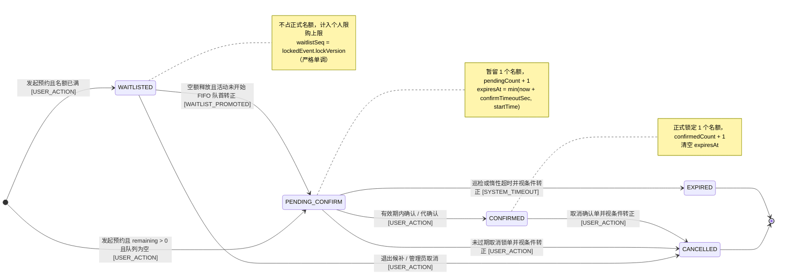

# System Architecture & API Contract (`docs/architecture.md`)

本文档定义「高并发活动预约与排队候补系统（Queue & Reservation Service）」的仓库边界、技术栈选型、Clean Architecture 分层约束、并发防超卖机制、状态机、后台巡检 Worker、RBAC 边界以及完整的前后端 REST/Zod 契约。

> **关联真相源（Truth Anchors）**
> - 视觉与交互基准：[demo/](file:///home/shenyun/dev/queue-reservation/demo)（由静态原型提供页面跳转与交互契约）
> - 架构决策记录：[docs/decisions.md](file:///home/shenyun/dev/queue-reservation/docs/decisions.md)（所有技术权衡、利弊分析与面试表达）
> - 数据模型与 Seed 契约：[docs/database.md](file:///home/shenyun/dev/queue-reservation/docs/database.md)（ER 模型、约束/索引、Prisma 7 规范与 Seed 契约）
> - 实施计划与门禁：`docs/plan.md`（数据模型定稿后落盘）

---

## 1. 技术栈与运行时约定

| 层级 | 选型 | 版本/关键说明 |
| :--- | :--- | :--- |
| **包管理与单仓** | `pnpm workspace` | 根 `package.json` 通过 `"packageManager": "pnpm@12.21.0"` + Corepack 锁定版本；统一管理 `packages/shared`、`backend`、`frontend` |
| **运行时** | Node.js | **`v26.13.1`**（本地与容器统一使用已核实存在的 `node:26.13.1-slim` 镜像） |
| **共享契约层** | TypeScript + Zod | `packages/shared` 采用 **source-only** 模式（`exports: { ".": "./src/index.ts" }`），前端由 Vite 直接消费、后端由 `tsx` / `tsc` 消费；为兼容 Node 26 原生类型剥离（type stripping），**严禁使用 TS `enum`、`namespace` 与参数属性**，所有枚举统一使用 `z.enum([...])` / `as const` |
| **后端框架** | Hono (`@hono/node-server`) + Zod | 轻量、原生 TypeScript、路由/校验与业务逻辑严格解耦；集成测试直接通过 `app.request()` 进程内并发调用 |
| **ORM 与数据库** | **Prisma 7+** (`@prisma/adapter-pg` + `pg`) + PostgreSQL 17 | Prisma 7 采用 `prisma.config.ts` 与 `prisma-client` 生成器（输出到 `backend/src/generated/prisma`，`.gitignore` 忽略并在安装/构建期生成）；`pg` 连接池显式配置 `max: DB_POOL_MAX`（默认 `30`）；运行时 100% ORM Only，物理 `CHECK` 约束落盘于 Prisma Migration DDL |
| **后端测试** | Vitest | 单元测试 + 独立测试库（`DATABASE_URL_TEST`）真实 PostgreSQL 集成测试（`fileParallelism: false`，每用例后运行 `assertEventInvariants`） |
| **前端框架** | React + TypeScript + Vite + Tailwind CSS + shadcn/ui | 严格复用 `src/components/ui/` 原语，对齐 `demo/` 页面结构 |
| **前端数据层** | TanStack Query (React Query) | 3 秒短轮询自动同步看板 + 写操作后即时 `invalidateQueries`（SSE 推送列为未来演进项） |
| **容器编排** | Docker Compose (`compose.yaml`) | 一键拉起 `postgres`、`backend`（含 `prisma` CLI，启动自动 migrate + seed）、`frontend` |

---

## 2. Monorepo 目录边界

```text
queue-reservation/
├── package.json                     # 根脚本（dev / build / typecheck / test / db:*）+ packageManager 锁定
├── pnpm-workspace.yaml              # workspaces: ['packages/*', 'backend', 'frontend']
├── compose.yaml                     # postgres(17-alpine) + backend + frontend 一键启动
├── demo/                            # 静态 HTML 视觉与交互原型（最高 UI 基准）
├── docs/
│   ├── architecture.md              # 本文件：架构、并发模型与 REST 契约
│   ├── decisions.md                 # 独立 ADR 决策记录（含评审修订记录与权衡）
│   ├── database.md                  # ER 模型、表结构、约束/索引、Seed 契约
│   └── plan.md                      # Phase 拆解、Worktree 任务与验收标准
├── packages/
│   └── shared/
│       └── src/
│           ├── enums.ts             # z.enum / as const（禁 TS enum）：Role, ReservationStatus, AuditTrigger, AvailabilityStatus
│           ├── errors.ts            # ErrorCode 常量与错误响应 Schema
│           ├── envelope.ts          # 统一响应信封 { data, meta? } / { error }
│           ├── schemas/             # user / event / reservation / audit / admin / stress Zod Schemas
│           └── index.ts             # 统一导出（source-only）
├── backend/
│   ├── prisma/
│   │   ├── schema.prisma            # 数据模型定义（Prisma 7）
│   │   ├── migrations/              # Prisma 迁移文件（含 Event/Reservation CHECK 约束 DDL）
│   │   └── seed.ts                  # 可幂等重跑的初始化 Seed 脚本
│   ├── prisma.config.ts             # Prisma 7 数据源与迁移配置
│   ├── src/
│   │   ├── generated/prisma/        # Prisma 7 生成客户端（.gitignore，构建期生成）
│   │   ├── app.ts                   # Hono 实例组装、全局中间件与 Prisma/业务错误映射
│   │   ├── server.ts                # HTTP 启动入口 + 定时 Worker 挂载 + 优雅停机
│   │   ├── routes/                  # Handler 层：Header/Body Zod 校验、调 Service、包装信封
│   │   ├── services/                # Usecase 层：状态机、applyTransition、releaseExpiredInLock、RBAC、压测
│   │   ├── repositories/            # Repository 接口定义 + Prisma 实现 + TransactionManager
│   │   ├── worker/                  # 10 秒超时巡检调度器（与 HTTP 解耦）
│   │   └── lib/                     # PrismaClient(pg adapter max=30)、AppError、Logger、Env、Clock
│   └── tests/
│       └── integration/             # 真实 DB 集成测试（含 resetTestDb 与 assertEventInvariants helper）
└── frontend/
    └── src/
        ├── components/ui/           # shadcn/ui 领域无关组件
        ├── components/layout/       # Topbar（身份切换、触发巡检、重置演示）、AuditDrawer
        ├── features/                # events / reservations / admin / stress-test 业务域
        └── lib/                     # 统一 apiClient（注 X-User-Id、Idempotency-Key 生命周期、解包 data 信封）
```

---

## 3. Clean Architecture 分层与事务边界

### 3.1 依赖方向红线
严格遵循单向依赖：
```text
routes (Handlers) ──▶ services (Usecases) ──▶ repositories (Interfaces) ◀── repositories/prisma (Impl) ──▶ PrismaClient
```

- **`routes/`**：仅负责解析 `X-User-Id`、`Idempotency-Key`、路径/查询参数与 JSON Body（用 `packages/shared` 的 Zod Schema 校验），调用对应 Service 方法，将返回值包装为统一信封 `{ data, meta? }` 并映射 HTTP 状态码。**严禁导入 `prisma` 或编写业务判断**。
- **`services/`**：承载全部核心业务规则（限购检查、防超卖编排、状态机校验、惰性超时判定、FIFO 候补转正、RBAC 权限校验、审计日志写入）。**严禁耦合 Hono `Context` / HTTP Request/Response，也不直接导入 `PrismaClient`**。
- **`repositories/`**：定义仓储接口（`UserRepository`、`EventRepository`、`ReservationRepository`、`AuditLogRepository`）及其 Prisma 实现。所有数据访问统一通过 Prisma Client（ORM Only）。

### 3.2 `TransactionManager`（回调式 Unit of Work）与 `Clock` 约定
为了在不破坏 Clean Architecture 边界的前提下保证跨表写操作（如：锁活动行 + 过期清理 + 创建/更新预约 + 更新活动计数 + 候补转正 + 写审计日志）的原子性，抽象轻量 `TransactionManager` 与 `Clock` 接口注入 Service：

```ts
export interface Clock {
  now(): Date;
}

export interface Repositories {
  users: UserRepository;
  events: EventRepository;
  reservations: ReservationRepository;
  auditLogs: AuditLogRepository;
}

export interface TransactionManager {
  run<T>(work: (repos: Repositories) => Promise<T>): Promise<T>;
}
```

- **超时与连接池配置**：`PrismaTransactionManager` 底层使用显式配置 `max: env.DB_POOL_MAX`（默认 **`30`**）的 `@prisma/adapter-pg` 连接池，并显式传入交互式事务选项：`prisma.$transaction((tx) => work(createPrismaRepositories(tx)), { maxWait: 10_000, timeout: 10_000 })`，避免 `pg` 默认 `max=10` 与 Prisma 默认 `maxWait=2000ms` 在 20 并发压测下触发 `P2028`。
- **提交后映射拒绝（硬规则 — 防回滚陷阱）**：**凡是会修改数据库状态的业务拒绝（例如：确认或取消时惰性检测到锁单已超时，需落库 `EXPIRED` + FIFO 转正后再返回 `409 RESERVATION_EXPIRED`），事务回调内部严禁 `throw AppError`**（抛异常会导致 `$transaction` 整体回滚，过期与转正丢失）。此类场景必须返回**判别联合结果对象**（如 `{ kind: 'EXPIRED', reservation, promoted }`），待 `txManager.run(...)` 正常提交后，再由外层 Service / Handler 映射为 `409` 或抛出业务异常。
- **统一后锁时间轴（`Clock`）**：所有写事务的当前时间 `now = clock.now()` 必须在 `lockForUpdate(eventId)` 返回**之后**获取，并显式写入 `createdAt` / `updatedAt` / `waitlistedAt` / `expiresAt` / 审计日志 `createdAt`，严禁混用数据库 `DEFAULT now()`（PostgreSQL 的 `now()` 取的是事务开始、等锁之前的时间，会与应用侧时间轴错位）。

---

## 4. 高并发防超卖与强一致架构（方案 D）

面对「多用户同一毫秒抢最后 1 个名额」且必须遵守 **ORM Only（禁止运行时手写裸 SQL）** 的约束，采用 **行锁串行化 + 集中式计数守恒 + DB `CHECK` 上溢防线** 组合设计：

### 4.1 主防线：事务首行 `Event` 行级排他锁串行化（纯 Prisma ORM）
所有涉及单活动名额变动的写事务（发起预约、确认预约、取消预约、Worker 过期回收、清空活动预约），在 `txManager.run(...)` 内的**第一步**必须执行：
```ts
const lockedEvent = await repos.events.lockForUpdate(eventId);
// Prisma 实现：
// tx.event.update({ where: { id: eventId }, data: { lockVersion: { increment: 1 } } })
```
- **锁模型成立性**：PostgreSQL 执行该 `UPDATE`（不改主键）获取的是 `FOR NO KEY UPDATE` 行锁，与插入 `Reservation` 时外键检查获取的 `FOR KEY SHARE` 兼容不冲突，同时阻塞同一 `Event` 的其他并发 `UPDATE` 直到事务提交。
- **零重试风暴与连接池边界**：同一活动的 20 路并发请求在数据库行锁处自动有序排队串行通过，不会触发 SSI 序列化冲突或乐观锁 CAS 重试风暴；**不同活动之间锁不同行，完全并行互不阻塞**。`pg` 连接池 `DB_POOL_MAX` 默认 `30`、压测并发上限 `<= DB_POOL_MAX - 5`（默认 `25`），保证压测期间 `GET` 查询与后台 Worker 仍有空闲连接可用。
- **快照可见性与防 TOCTOU 硬规则**：
  - 在 PostgreSQL 默认 `ReadCommitted` 隔离级别下，事务 B 等待事务 A 提交并释放行锁后，事务 B 后续所有读取均获取最新已提交快照。
  - **防 TOCTOU 硬规则**：对于 `POST /api/reservations/:id/confirm` 与 `POST /api/reservations/:id/cancel` 等仅传入 `reservationId` 的接口，**加锁前读取的 `Reservation` 仅允许用于获取 `eventId`（及初筛 404）；拿到 `Event` 行锁后，必须在事务内重新读取该 `Reservation`**（并校验当前状态），严禁沿用锁前快照做状态判断、计数扣减或候补转正。
- **零死锁保证**：全系统所有写事务强制遵守固定加锁顺序 `events -> reservations -> reservation_audit_logs`；Worker 按 `eventId ASC` 逐活动独立开事务；`reset-seed` 按 `id ASC` 锁定全部现有 `Event` 行后再清理。

### 4.2 辅助防线：集中式 `applyTransition` 计数守恒 + PostgreSQL `CHECK` 上溢约束
在 `Event` 表维护两个受行锁保护的计数字段：`confirmedCount`、`pendingCount`，并在数据库 Migration DDL 中施加物理 `CHECK` 约束：
```sql
ALTER TABLE "events"
  ADD CONSTRAINT "events_counts_non_negative_chk"
    CHECK ("confirmed_count" >= 0 AND "pending_count" >= 0),
  ADD CONSTRAINT "events_no_oversell_chk"
    CHECK ("confirmed_count" + "pending_count" <= "capacity");
```
- **防线边界精准界定**：**`Event` 行锁串行化 + 集中式计数守恒是防超卖的主防线；`CHECK` 约束负责防止计数字段上溢（`confirmed_count + pending_count > capacity`）或负值**。由于 `CHECK` 校验的是冗余计数字段而非实时 `COUNT(*)` 行数，若代码出现计数漏加/重复扣减导致的“计数偏低漂移”，`CHECK` 无法独自发现。因此工程上通过三条强制约束保证计数与真实行 100% 守恒：
  1. **单一计数变更入口**：除“清空活动预约”在行锁内将两计数归零外，所有状态流转的计数增减必须统一调用纯查表函数 `applyTransition(fromStatus, toStatus)`（直接映射 §5.1 状态表），禁止在各处手写 `confirmedCount ± 1` / `pendingCount ± 1`。
  2. **真实行数校验 `oversold`**：管理台 `stats.oversold` 与 P1 压测战报 `summary.oversold` 必须基于 **`Reservation` 表真实行数**（`actualConfirmed + actualPending > capacity`）计算，不能仅看冗余计数字段。
  3. **每用例不变量断言**：所有后端集成测试结束时必须运行 `assertEventInvariants(eventId)`，校验 `confirmedCount === actualConfirmed`、`pendingCount === actualPending`、`actualConfirmed + actualPending <= capacity` 及未截止活动「有余量则候补队列必为空」。

### 4.3 严格幂等控制（`Idempotency-Key`）
- `POST /api/events/:eventId/reservations` **强制要求**请求头携带 `Idempotency-Key`（缺失或为空返回 `400 VALIDATION_ERROR`）。
- 唯一作用域为 `(eventId, userId, idempotencyKey)`（有意包含 `eventId`，同一 key 跨不同活动使用不视为冲突）：
  1. **严格检查顺序**：鉴权/RBAC → 锁 `Event` → 取锁后时间 `now` → `releaseExpiredInLock` → **幂等查找** → `EVENT_ENDED` → `maxPerUser` → 余量分配。幂等查找必须在 `EVENT_ENDED` 与 `maxPerUser` 之前执行，防止 `maxPerUser = 1` 时并发双击第二下误报 `409`。
  2. **重放返回语义**：命中幂等重放时返回 HTTP `200` 与 `meta.idempotentReplay = true`，返回体为该预约单的**最新当前状态**（例如原单已被确认、取消或过期则返回其当前状态，而非首次提交时的历史快照）。
  3. **唯一索引兜底**：数据库层 `@@unique([eventId, userId, idempotencyKey])` 作为最终兜底；若极端路径触发 Prisma `P2002`，捕获后重新读取该记录并按幂等重放（HTTP `200`, `meta.idempotentReplay = true`）返回。

### 4.4 写事务标准模板与共享领域原语（伪代码）

> 以下标准模板固定了所有写路径的执行顺序，同时覆盖防 TOCTOU（P1-1）、提交后映射 409（P1-2）、集中式计数守恒（P1-3）、后锁时间与 `waitlistSeq`（P2-1）、统一过期回收防插队（P2-2）与 `EVENT_ENDED` 截止口径（P2-4）。

```ts
// 1) 单一计数增量查表（与 §5.1 状态表 1:1 对应）
export function applyTransition(
  from: ReservationStatus | null,
  to: ReservationStatus,
): { confirmedDelta: number; pendingDelta: number } {
  const key = `${from ?? 'NULL'}->${to}`;
  const table: Record<string, { confirmedDelta: number; pendingDelta: number }> = {
    'NULL->PENDING_CONFIRM':            { confirmedDelta: 0,  pendingDelta: +1 },
    'NULL->WAITLISTED':                 { confirmedDelta: 0,  pendingDelta: 0  },
    'PENDING_CONFIRM->CONFIRMED':       { confirmedDelta: +1, pendingDelta: -1 },
    'PENDING_CONFIRM->EXPIRED':         { confirmedDelta: 0,  pendingDelta: -1 },
    'PENDING_CONFIRM->CANCELLED':       { confirmedDelta: 0,  pendingDelta: -1 },
    'CONFIRMED->CANCELLED':             { confirmedDelta: -1, pendingDelta: 0  },
    'WAITLISTED->CANCELLED':            { confirmedDelta: 0,  pendingDelta: 0  },
    'WAITLISTED->PENDING_CONFIRM':      { confirmedDelta: 0,  pendingDelta: +1 },
  };
  const delta = table[key];
  if (!delta) throw new AppError('INVALID_STATE_TRANSITION', 409);
  return delta;
}

// 2) 锁内共享过期回收与候补转正原语（Worker / create / confirm / cancel 全部复用）
async function releaseExpiredInLock(
  repos: Repositories,
  event: EventRecord,
  now: Date,
): Promise<{ event: EventRecord; expiredIds: string[]; promoted: ReservationRecord[] }> {
  const overdue = await repos.reservations.findOverduePendingByEvent(event.id, now);
  let currentEvent = event;
  const expiredIds: string[] = [];
  const promoted: ReservationRecord[] = [];

  for (const item of overdue) {
    // PENDING_CONFIRM -> EXPIRED (pendingCount - 1)
    const d1 = applyTransition('PENDING_CONFIRM', 'EXPIRED');
    await repos.reservations.markExpired(item.id, now);
    currentEvent = await repos.events.adjustCounts(currentEvent.id, d1);
    await repos.auditLogs.create({
      reservationId: item.id, eventId: currentEvent.id,
      fromStatus: 'PENDING_CONFIRM', toStatus: 'EXPIRED',
      trigger: 'SYSTEM_TIMEOUT', actorId: null,
      note: '未在规定时间内确认，系统已自动释放名额', createdAt: now,
    });
    expiredIds.push(item.id);

    // 仅当活动尚未开始（now < event.startTime）时尝试 FIFO 转正
    if (now < currentEvent.startTime) {
      const next = await promoteNextWaitlistedInLock(repos, currentEvent, now);
      if (next) {
        currentEvent = next.event;
        promoted.push(next.promoted);
      }
    }
  }
  return { event: currentEvent, expiredIds, promoted };
}

// 3) 写事务标准模板示例：确认 / 取消（不抛异常回滚已提交的过期与转正）
async function confirmOrCancelReservation(actor: User, reservationId: string, action: 'CONFIRM' | 'CANCEL') {
  // 锁前仅用于获取 eventId（严禁复用此快照做状态决策）
  const lookup = await readRepos.reservations.findById(reservationId);
  if (!lookup) throw new AppError('RESERVATION_NOT_FOUND', 404);

  const outcome = await txManager.run(async (repos) => {
    // Step 1: 事务首行锁定 Event（若不存在映射 P2025 -> 404）
    const lockedEvent = await repos.events.lockForUpdate(lookup.eventId);
    // Step 2: 锁后获取统一时间戳
    const now = clock.now();
    // Step 3: 先执行统一过期回收 + 转正
    const { event: freshEvent, expiredIds, promoted: expiredPromoted } =
      await releaseExpiredInLock(repos, lockedEvent, now);
    // Step 4: 锁内重新读取目标预约单（杜绝 TOCTOU）
    const current = await repos.reservations.findById(reservationId);
    if (!current) return { kind: 'NOT_FOUND' as const };
    if (actor.role !== 'ADMIN' && current.userId !== actor.id) return { kind: 'FORBIDDEN' as const };

    // 若目标单刚在本事务中被惰性置为 EXPIRED -> 正常提交事务，由外层映射 409
    if (expiredIds.includes(current.id)) {
      return { kind: 'LAZILY_EXPIRED' as const, reservation: current, promoted: expiredPromoted };
    }

    // Step 5: 状态流转 + applyTransition 改计数 + 写审计日志（+ 取消且 now < startTime 时转正）
    // 若状态不允许流转，返回 { kind: 'INVALID_TRANSITION' }（不回滚 Step 3 已完成的他人过期回收）
    return executeTransitionInLock(repos, freshEvent, current, actor, action, now);
  });

  // Step 6: 事务已提交，外层映射 HTTP / AppError 与按角色裁剪字段
  if (outcome.kind === 'NOT_FOUND') throw new AppError('RESERVATION_NOT_FOUND', 404);
  if (outcome.kind === 'FORBIDDEN') throw new AppError('FORBIDDEN', 403);
  if (outcome.kind === 'LAZILY_EXPIRED') throw new AppError('RESERVATION_EXPIRED', 409);
  if (outcome.kind === 'INVALID_TRANSITION') throw new AppError('INVALID_STATE_TRANSITION', 409);
  return formatResponseByRole(actor.role, outcome);
}
```

> **发起预约（`createReservation`）锁内固定顺序**：
> 1. `lockForUpdate(eventId)`（`P2025` → `404 EVENT_NOT_FOUND`）
> 2. `now = clock.now()`
> 3. `releaseExpiredInLock(repos, lockedEvent, now)`（保证过期名额先归还/转正，新请求既不会误入候补也不会插队越过候补队首）
> 4. **幂等查找** `(eventId, userId, idempotencyKey)` → 命中则直接返回当前预约单（HTTP `200`, `meta.idempotentReplay = true`）
> 5. **`EVENT_ENDED` 校验**：若 `now >= event.startTime`，返回 `{ kind: 'EVENT_ENDED' }`（提交后映射 `409 EVENT_ENDED`）
> 6. **`maxPerUser` 校验**：统计该用户在本活动活跃单数（`CONFIRMED | PENDING_CONFIRM | WAITLISTED`），若 `>= event.maxPerUser` 返回 `{ kind: 'MAX_PER_USER_EXCEEDED' }`
> 7. **名额判定（防插队不变量）**：计算 `remaining = capacity - confirmedCount - pendingCount` 与 `waitlistedCount`。**仅当 `remaining > 0 && waitlistedCount === 0`** 时分配 `PENDING_CONFIRM`（`expiresAt = min(now + confirmTimeoutSec, event.startTime)`，`applyTransition(null, 'PENDING_CONFIRM')`）；否则进入 `WAITLISTED`（`waitlistedAt = now`，**`waitlistSeq = lockedEvent.lockVersion`**，`applyTransition(null, 'WAITLISTED')`）
> 8. 写入 `ReservationAuditLog`（`createdAt: now`）并返回 `201`。

---

## 5. 预约状态机与审计日志规范

### 5.1 状态枚举与合法流转



| `fromStatus` | `toStatus` | 触发源 (`trigger`) | 触发条件 | 计数变化 (`Event`) | 联动副作用 |
| :--- | :--- | :--- | :--- | :--- | :--- |
| `null` | `PENDING_CONFIRM` | `USER_ACTION` | `now < startTime`、`remaining > 0 && waitlistedCount === 0` 且未超 `maxPerUser` | `pendingCount + 1` | 设置 `expiresAt = min(now + confirmTimeoutSec, event.startTime)` |
| `null` | `WAITLISTED` | `USER_ACTION` | `now < startTime`、名额已满且未超 `maxPerUser` | 不变 | 记录 `waitlistedAt = now`、`waitlistSeq = lockedEvent.lockVersion`，动态返回 `waitlistRank` |
| `PENDING_CONFIRM` | `CONFIRMED` | `USER_ACTION` | `now <= expiresAt` 且为本人或 Admin | `pendingCount - 1`, `confirmedCount + 1` | 清空 `expiresAt`，记录 `confirmedAt = now` |
| `PENDING_CONFIRM` | `EXPIRED` | `SYSTEM_TIMEOUT` | Worker 或 `create/confirm/cancel` 内 `releaseExpiredInLock` 检测到 `now > expiresAt` | `pendingCount - 1` | 清空 `expiresAt`，记录 `expiredAt = now`；**若 `now < event.startTime` 同事务触发 FIFO 队首转正** |
| `PENDING_CONFIRM` | `CANCELLED` | `USER_ACTION` | 本人主动取消或 Admin 强制取消（**未过期** `now <= expiresAt`） | `pendingCount - 1` | 清空 `expiresAt`，记录 `cancelledAt = now`；**若 `now < event.startTime` 同事务触发 FIFO 队首转正** |
| `CONFIRMED` | `CANCELLED` | `USER_ACTION` | 本人主动取消或 Admin 强制取消 | `confirmedCount - 1` | 记录 `cancelledAt = now`；**若 `now < event.startTime` 同事务触发 FIFO 队首转正** |
| `WAITLISTED` | `CANCELLED` | `USER_ACTION` | 本人退出候补或 Admin 强制取消 | 不变 | 记录 `cancelledAt = now`（后续候补顺位自动前移） |
| `WAITLISTED` | `PENDING_CONFIRM` | `WAITLIST_PROMOTED` | 释放出空闲名额、`now < event.startTime` 且存在候补队列 | `pendingCount + 1` | 选 `waitlistSeq ASC` 队首，设置新 `expiresAt = min(now + confirmTimeoutSec, event.startTime)` |

> **关键边界说明**：
> - **统一惰性超时校验（含确认与取消）**：Worker、`create`、`confirm`、`cancel` 在锁住 `Event` 后均第一时间调用 `releaseExpiredInLock`。当用户/Admin 对一条已超时（`now > expiresAt`）的 `PENDING_CONFIRM` 点击**确认或取消**时，`releaseExpiredInLock` 会在当前事务内将其置为 `EXPIRED`（`SYSTEM_TIMEOUT`）并在活动未开始时触发 FIFO 转正；事务正常提交后，服务端统一向调用方返回 `409 RESERVATION_EXPIRED`（绝不允许已过期单被确认或被伪装成用户主动取消）。
> - **`EVENT_ENDED` 截止规则**：统一以 **`now >= event.startTime`** 作为预约与转正截止点：
>   - `now >= startTime` 时，活动 `availabilityStatus` 为 `CLOSED`，新预约请求返回 `409 EVENT_ENDED`（在幂等检查之后判定）。
>   - `expiresAt` 上限钳制为 `min(now + confirmTimeoutSec, event.startTime)`，不会晚于活动开始时间。
>   - 活动开始后，Worker 与惰性回收仍会把超时的 `PENDING_CONFIRM` 置为 `EXPIRED` 释放计数，且允许取消已有预约，但**均不再触发候补转正**。
> - **限购口径**：`maxPerUser` 统计用户在当前活动下处于 `CONFIRMED`、`PENDING_CONFIRM`、`WAITLISTED` 三种活跃状态的预约总数；变为 `CANCELLED` 或 `EXPIRED` 后额度自动释放。
> - **单次预约数量**：每次请求固定占 1 个名额（若 `maxPerUser > 1`，允许同一用户发起多次预约，生成多条独立预约单，各自独立流转与取消）。
> - **严格单调 FIFO 候补顺位**：进入候补时记录 `waitlistSeq = lockedEvent.lockVersion`（因 `Event` 行锁每次写事务严格自增 `lockVersion`，活动内全局严格单调无并列）。候补顺位不静态存储，查询时按 `waitlistSeq ASC` 实时计算排在当前记录之前的 `WAITLISTED` 数量 `+ 1`。

### 5.2 审计日志（`ReservationAuditLog`）
每一次状态创建或变更都在同一事务内写入一条不可变日志：
- `reservationId`、`eventId`
- `fromStatus`（首次创建为 `null`）
- `toStatus`
- `trigger`：`USER_ACTION` | `SYSTEM_TIMEOUT` | `WAITLIST_PROMOTED`
- `actorId`：操作用户 ID（系统超时/自动转正时为 `null`；管理员代确认/强制取消时记录管理员 `userId`）
- `note`：人类可读的状态变更说明（如「管理员代确认预约」「未在规定时间内确认，系统已自动释放名额」「有空余名额释放，候补自动转正」）
- `createdAt`（显式写入事务锁后 `now`）

---

## 6. 后台 10 秒超时巡检 Worker 设计（方案 A）

- **部署形态**：内嵌在 `backend` 进程中，模块位于 `backend/src/worker/expiration-worker.ts`，与 HTTP 路由解耦（未来可零改动抽成独立 Worker 容器）。
- **调度机制**：
  - 每 **10 秒** 触发一次 `ReservationService.expireOverdueReservations()`。
  - 内置 `isRunning` 防重入锁，避免慢查询导致重叠执行。
  - 维护内存状态 `lastWorkerRunAt`（并在接口 `meta.lastWorkerRunAt` 返回给运营看板展示）。
  - 进程收到 `SIGINT` / `SIGTERM` 时停止定时器并等待当前轮次完成后优雅退出。
  - 通过环境变量 `ENABLE_EXPIRATION_WORKER` 控制自动开启（开发/容器环境默认 `true`，Vitest 集成测试默认 `false`，测试中直接调用 Service 或手动触发接口验证）。
- **事务粒度与 SQL 下推**：
  1. 先无锁轻量扫描：使用 `reservation.groupBy({ by: ['eventId'], where: { status: 'PENDING_CONFIRM', expiresAt: { lte: now } }, orderBy: { eventId: 'asc' } })` 获取存在过期锁单的 `eventId` 列表（相比 `distinct` 可确保 Prisma 下推为 SQL `GROUP BY`）。
  2. 针对每个 `eventId` 单独开启一个 `txManager.run(...)` 事务：先锁 `Event` 行 → 取锁后 `now = clock.now()` → 直接复用 `releaseExpiredInLock(repos, lockedEvent, now)` 完成过期回收、计数维护、审计写入与条件 FIFO 转正。
  3. 即使未来多实例部署，因与用户写请求共享同一 `Event` 行锁，绝无重复过期或重复转正问题。

---

## 7. RBAC 权限与关键业务边界（对齐 `demo/`）

本项目通过请求头 `X-User-Id` 识别当前模拟账号（无真实 JWT），**所有权限隔离与字段裁剪必须在后端强校验**，绝不依赖前端隐藏 DOM：

> **安全边界声明**：`X-User-Id` 模拟身份切换是面向面试原型演示的有意简化（任何调用方均可携带 `X-User-Id: admin` 发起请求），**不构成生产级认证安全边界**；生产环境仅需在 `routes/` 层将 `X-User-Id` 中间件替换为 JWT / OAuth2 验签中间件即可（Service 层无感）。

1. **角色分离与字段裁剪**：
   - `USER`（C 端普通用户，Seed 预置 5 人：`Alice`、`Bob`、`Charlie`、`Diana`、`Evan`）：
     - 仅可浏览活动公开信息与可用状态（`AVAILABLE` / `WAITLIST_ONLY` / `CLOSED`，其中 `now >= startTime` 为 `CLOSED`），**后端裁剪掉 `capacity`、`confirmedCount`、`pendingCount`、`waitlistedCount`、`remainingCapacity`、`confirmTimeoutSec` 等敏感运营数据**。
     - 仅可发起预约、查看/确认/取消**本人**的预约、查看**本人**的审计日志。
     - **取消响应防泄露**：`USER` 调用 `POST /api/reservations/:id/cancel` 触发他人候补转正时，后端**必须裁剪掉他人信息，返回 `promotedReservation: null`**（仅 `ADMIN` 可收到完整的 `promotedReservation` DTO）；`ReservationDetailDto` 在 `USER` 视角下亦不包含其他用户的 `userId`/`userName`。
   - `ADMIN`（运营管理员，Seed 预置 1 人：`Admin`）：
     - 可查看全量活动实时看板 KPI（其中 `waitlistedCount` 口径为**候补单数**；当 `maxPerUser = 1` 时等价于候补人数，`maxPerUser > 1` 时代表排队中的候补申请单数，前后端文案统一使用「候补单数 / 候补队列」）、全量预约名册与候补队列、全局统计与 `lastWorkerRunAt`。
     - 可创建活动、对任意用户的预约执行**代确认 / 强制取消**、查看任意预约的审计日志、手动触发超时巡检、重置演示数据、执行 P1 并发压测与清空活动预约。
     - **禁止作为 C 端自己下单**：调用 `POST /api/events/:eventId/reservations` 时，后端校验 `user.role === 'USER'`，管理员调用直接返回 `403 FORBIDDEN`。
2. **`maxPerUser > 1` 的前端交互边界**：
   - 前端正式版在活动详情页不能仅读取第 1 条活跃预约；应展示该用户在本活动下的**全部活跃预约列表**，只要 `myActiveReservations.length < event.maxPerUser` 且活动未截止，仍显示「继续预约」按钮并允许针对每条活跃预约单独确认/取消/查看进度。
3. **压测虚拟用户隔离（`User.isSimulated`）**：
   - `User` 表增加 `isSimulated: boolean`（默认 `false`）。
   - P1 并发压测自动创建/复用的虚拟压测用户（如 `sim-{batch}-{i}`）标记为 `isSimulated = true`，以满足 PostgreSQL 外键约束。
   - `GET /api/users` 默认仅返回 `isSimulated = false` 的 6 个常规模拟账号，不污染顶部账号切换器。

---

## 8. 统一 REST API 契约

### 8.1 统一响应信封与错误规范

- **成功响应（HTTP `200` / `201`）**：
  ```json
  {
    "data": { "...": "..." },
    "meta": {
      "requestId": "req-uuid",
      "serverTime": "2026-11-21T13:00:00.000Z"
    }
  }
  ```
  > 注：`meta` 可按接口携带扩展字段，例如 `idempotentReplay: boolean`、`lastWorkerRunAt: string | null`、`total: number`。

- **错误响应（HTTP `4xx` / `5xx`）**：
  ```json
  {
    "error": {
      "code": "RESERVATION_EXPIRED",
      "message": "该预约已超过确认时限，名额已自动释放",
      "details": {}
    }
  }
  ```

- **统一请求头**：
  - `X-User-Id`: 当前操作用户 ID（除 `GET /api/health`、`GET /api/users` 外均建议携带；写接口与鉴权接口必填，缺失返回 `401 UNAUTHORIZED`，不存在返回 `401 USER_NOT_FOUND`）。
  - `Idempotency-Key`: `POST /api/events/:eventId/reservations` **必填**，缺失或空串返回 `400 VALIDATION_ERROR`。

- **稳定错误码清单**：
  | ErrorCode | HTTP Status | 语义 |
  | :--- | :--- | :--- |
  | `VALIDATION_ERROR` | `400` | 请求参数、Body 或必填 Header（含 `Idempotency-Key`）校验失败 |
  | `UNAUTHORIZED` | `401` | 缺失 `X-User-Id` |
  | `USER_NOT_FOUND` | `401` | `X-User-Id` 对应用户不存在 |
  | `FORBIDDEN` | `403` | 越权访问（如普通用户调 Admin 接口、访问他人预约/审计日志、Admin 尝试下单） |
  | `EVENT_NOT_FOUND` | `404` | 活动不存在（含并发 `reset-seed` 期间原活动行被删除引发的 `P2025`） |
  | `RESERVATION_NOT_FOUND` | `404` | 预约单不存在 |
  | `EVENT_ENDED` | `409` | 活动已开始或已结束（`now >= startTime`），停止接受新预约 |
  | `MAX_PER_USER_EXCEEDED` | `409` | 用户在该活动的活跃预约数已达 `maxPerUser` 上限 |
  | `RESERVATION_EXPIRED` | `409` | **确认或取消** `PENDING_CONFIRM` 时惰性发现已超时（服务端已正常提交过期与条件候补转正，再返回本错误码） |
  | `INVALID_STATE_TRANSITION` | `409` | 当前预约状态不允许执行该操作（如已取消/已确认单再次确认或重复取消） |
  | `SERVICE_BUSY` | `503` | 数据库事务等待超时或高并发锁争用（`P2028` / `P2034`），客户端可沿用同一 `Idempotency-Key` 重试 |
  | `INTERNAL_ERROR` | `500` | 未知服务端异常（不透出数据库或堆栈细节） |

- **Prisma 错误到业务错误映射（全局错误处理器）**：
  | Prisma Error Code | 典型触发场景 | 统一映射行为 |
  | :--- | :--- | :--- |
  | `P2025` | `lockForUpdate(eventId)` 命中不存在的 `eventId`，或并发请求在 `reset-seed` 提交后命中被删旧行 | 映射为 `404 EVENT_NOT_FOUND`（严禁落成 `500`） |
  | `P2002` | `reservations` 幂等唯一键 `(eventId, userId, idempotencyKey)` 兜底冲突 | 重新读取该记录，按 HTTP `200` + `meta.idempotentReplay = true` 返回当前状态 |
  | `P2028` / `P2034` | 交互式事务连接池等待超时或并发锁冲突 | 映射为 `503 SERVICE_BUSY`（可重试） |

### 8.2 接口总览（P0 与 P1）

#### P0 核心闭环接口

| 方法与路径 | 权限 | 说明 | 请求要点 | 响应 `data` / `meta` 要点 |
| :--- | :--- | :--- | :--- | :--- |
| `GET /api/health` | 公开 | 健康检查 | - | `data: { status: 'ok', db: 'up', workerEnabled: boolean, lastWorkerRunAt }` |
| `GET /api/users` | 公开 | 获取顶部模拟切换账号列表 | `?includeSimulated=false` | `data: UserDto[]`（默认仅返回 5 个普通用户 + 1 个 Admin） |
| `GET /api/events` | `USER \| ADMIN` | 活动列表（按角色裁剪字段） | Header: `X-User-Id` | `USER`: 活动基本信息 + `availabilityStatus` (`AVAILABLE \| WAITLIST_ONLY \| CLOSED`) + `myActiveReservations[]`；<br>`ADMIN`: 活动全部规则 + `stats { capacity, confirmedCount, pendingCount, waitlistedCount, occupiedCount, remainingCapacity, oversold }`（`oversold` 按真实预约行校验）；<br>`meta: { total, lastWorkerRunAt }` |
| `POST /api/events` | `ADMIN` | 创建新活动 | Header: `X-User-Id`<br>Body: `{ name, description?, startTime, endTime, capacity, maxPerUser, confirmTimeoutSec }` | `201`, `data: AdminEventDto` |
| `GET /api/events/:eventId` | `USER \| ADMIN` | 活动详情 | Header: `X-User-Id`<br>Query(Admin): `?tab=OCCUPIED\|WAITLISTED\|CLOSED\|ALL` | `USER`: `{ event: PublicEventDto, myActiveReservations, myHistory }`；<br>`ADMIN`: `{ event: AdminEventDto, reservations: ReservationWithUserDto[] }` |
| `POST /api/events/:eventId/reservations` | `USER`（禁 `ADMIN`） | **发起预约（核心防超卖 + 严格幂等）** | Header: `X-User-Id`, `Idempotency-Key` | `201`（幂等重放为 `200`，返回最新当前状态）<br>`data: ReservationDetailDto`（含 `status`, `expiresAt`, `waitlistRank`）<br>`meta: { idempotentReplay: boolean }` |
| `GET /api/reservations/me` | `USER` | 查询「我的预约」列表 | Header: `X-User-Id`<br>Query: `?status=ALL\|PENDING_CONFIRM\|CONFIRMED\|WAITLISTED\|CLOSED` | `data: ReservationWithEventDto[]`（含实时 `waitlistRank` 与活动摘要；`CLOSED` 对应 `CANCELLED \| EXPIRED`） |
| `POST /api/reservations/:id/confirm` | 本人 或 `ADMIN` | 确认预约（支持 Admin 代确认 + 惰性超时） | Header: `X-User-Id` | `200`, `data: ReservationDetailDto`；若超时已落库 `EXPIRED`+转正后返回 `409 RESERVATION_EXPIRED` |
| `POST /api/reservations/:id/cancel` | 本人 或 `ADMIN` | 取消预约（并同事务按条件触发 FIFO 队首转正） | Header: `X-User-Id` | `200`, `data: { reservation: ReservationDetailDto, promotedReservation }`：**`USER` 角色恒为 `null`（防泄露他人数据），`ADMIN` 返回 `ReservationWithUserDto \| null`**；若目标已超时则落库 `EXPIRED`+转正后返回 `409 RESERVATION_EXPIRED` |
| `GET /api/reservations/:id/audit-logs` | 本人 或 `ADMIN` | 单笔预约完整状态变更时间线（详情抽屉） | Header: `X-User-Id` | `200`, `data: { reservation: ReservationSummaryDto, logs: AuditLogDto[] }` |
| `POST /api/admin/worker/expire` | `ADMIN` | 手动立即触发一次超时巡检 | Header: `X-User-Id` | `200`, `data: { expiredCount, promotedCount, lastWorkerRunAt }` |
| `POST /api/admin/reset-seed` | `ADMIN`（非生产） | 重置演示数据库回初始 Seed 状态 | Header: `X-User-Id` | `200`, `data: { reset: true, eventsCount, usersCount }` |

#### P1 并发压测加分接口

| 方法与路径 | 权限 | 说明 | 请求要点 | 响应 `data` 要点 |
| :--- | :--- | :--- | :--- | :--- |
| `DELETE /api/events/:eventId/reservations` | `ADMIN` | 清空指定活动预约与审计日志并重置计数（便于从 0 压测） | Header: `X-User-Id` | `200`, `data: { deletedReservationsCount }` |
| `POST /api/events/:eventId/simulate-burst` | `ADMIN` | **服务端同毫秒并发压测**（自动准备 N 个 `isSimulated=true` 用户并以 `Promise.all` 并发调用真实预约 Service） | Header: `X-User-Id`<br>Body: `{ concurrency: 20 }`（范围 `1 ~ min(25, DB_POOL_MAX - 5)`，预留连接给读请求与 Worker） | `200`, `data: { eventStatsAfter, summary: { totalRequests, pendingCount, waitlistedCount, failedCount, durationMs, oversold }, results: [{ index, userId, userName, idempotencyKey, ok, reservation?, waitlistRank?, error?, latencyMs }] }`（**`summary.oversold` 按真实 `Reservation` 行数计算**） |

---

## 9. 前端数据同步与工程规范

- **统一 `apiClient`**：
  - 自动从当前模拟用户上下文注入 `X-User-Id`。
  - **`Idempotency-Key` 生命周期**：每次「用户发起预约意图」生成一个新 UUID；请求进行中禁用按钮防双击；若遇网络异常或 `5xx` / `503 SERVICE_BUSY` 重试则**沿用同一个 key**；一旦收到任意 `2xx` 或明确的 `4xx` 响应立即作废该 key，下次意图重新生成。
  - 统一解包 `{ data, meta }`，并将 `{ error }` 映射为标准化的 `ApiError` 供 Toast 与错误边界展示。
- **实时同步策略（方案 A）**：
  - 活动看板、活动详情、我的预约列表通过 TanStack Query 设置 `refetchInterval: 3000`（3 秒短轮询），保证后台 10 秒 Worker 自动释放/转正后最多 3 秒内前端自动刷新。
  - 任何写操作（预约、确认、取消、创建活动、手动巡检、压测、重置）成功后立即 `invalidateQueries` 实现即时反馈。
  - 待确认倒计时基于服务端返回的 `expiresAt` 与 `meta.serverTime` 偏移量本地每秒递减渲染。
- **四态完整**：所有页面严格处理 `loading`（骨架/加载态）、`empty`、`error`（含重试按钮）、`success`。

---

## 10. 运行、日志、容器编排与测试基线

### 10.1 日志落盘
- 后端与前端开发启动脚本统一将 `stdout`/`stderr` 重定向写入 `.logs/backend.log` 与 `.logs/frontend.log`。
- 后端使用结构化 JSON 日志（记录 `requestId`、`method`、`path`、`status`、`durationMs`、`userId`、Worker 巡检摘要及异常堆栈，严禁打印敏感凭证）。

### 10.2 一键容器编排（`compose.yaml`）
- **`postgres`**：`postgres:17-alpine`，带 `pg_isready` 健康检查与持久化卷。
- **`backend`**：基于已验证的 `node:26.13.1-slim` + `corepack enable`（锁定 `pnpm@12.21.0`）：
  - Dockerfile 必须拷贝根 `package.json`、`pnpm-workspace.yaml`、`pnpm-lock.yaml`、`packages/shared` 与 `backend`；
  - 构建期执行 `pnpm --filter @queue-reservation/backend prisma generate` 生成 `backend/src/generated/prisma`；
  - 运行时镜像保留 `prisma` CLI 与 `tsx`（供容器启动时执行 `prisma migrate deploy && prisma db seed`）后拉起 Hono 服务（暴露 `3000`），默认配置 `DB_POOL_MAX=30`。
- **`frontend`**：Vite 静态构建由 Nginx 托管并反向代理 `/api/*` 至 `backend:3000`（暴露 `5173` 或 `8080`）。

### 10.3 自动化测试与验收基线（落入 `docs/plan.md`）
- **隔离与执行配置**：
  - 使用独立测试数据库（`DATABASE_URL_TEST`），集成测试配置 Vitest `fileParallelism: false` 避免用例间污染。
  - 每个用例开始前通过测试辅助 `resetTestDb()` 执行 `TRUNCATE TABLE "reservation_audit_logs", "reservations", "events", "users" RESTART IDENTITY CASCADE`（此为测试夹具例外，非运行时业务代码）。
  - 并发 HTTP 测试直接通过 Hono `app.request()` 进程内并发执行，无需绑定端口。
- **必过核心集成测试矩阵（每条用例结束必跑 `assertEventInvariants(eventId)`）**：
  1. **20 抢 5 防超卖**：动态创建 20 名测试用户、`capacity = 5, maxPerUser = 1`，通过 `Promise.all` 并发调用 `app.request()`，断言 5 条 `PENDING_CONFIRM`、15 条 `WAITLISTED`、零超卖、候补 `waitlistSeq` 严格单调无重复。
  2. **取消后 FIFO 转正与权限裁剪**：确认单/锁单取消后，队首候补自动转正为 `PENDING_CONFIRM`；且 `USER` 视角取消响应中 `promotedReservation === null`，`ADMIN` 视角返回完整转正 DTO。
  3. **惰性过期落库 + 409**：过期后调用 `confirm` 返回 `409 RESERVATION_EXPIRED`，**且断言数据库中该单已落库为 `EXPIRED`、候补队首已转正**；过期后调用 `cancel` 同样落库 `EXPIRED`+转正并返回 `409 RESERVATION_EXPIRED`。
  4. **同一预约并发 `cancel × 2`（防 TOCTOU）**：断言仅 1 次成功、1 次 `409 INVALID_STATE_TRANSITION`，仅转正 1 人、计数严格守恒。
  5. **幂等双击**：`maxPerUser = 1` 下携带相同 `Idempotency-Key` 并发提交两次，断言 1 次 `201` + 1 次 `200 (idempotentReplay=true)`、不误报 `MAX_PER_USER_EXCEEDED`。
  6. **多份限购（`maxPerUser = 2`）**：同一用户一单 `PENDING_CONFIRM` + 一单 `WAITLISTED`，验证独立确认/取消/转正与计数守恒。
  7. **活动已开始截止（`EVENT_ENDED`）**：`now >= startTime` 时新预约返回 `409 EVENT_ENDED`，过期回收与取消不再触发候补转正。
- **限时原型可裁剪优先级（如时间吃紧，按由后往前顺序保留核心闭环）**：
  1. 优先保障 P0 全部后端接口 + 集成测试 + 4 个核心页面 + `compose.yaml`；
  2. 可降级顺序：`simulate-burst` / 清空活动预约（P1） → `reset-seed` 快捷按钮 → Admin `?tab` 服务端过滤（可前端本地过滤） → SSE（明确归入 Future Roadmap）。

---

## 11. 未来演进路线（Future Roadmap）

以下能力超出 3 小时 MVP 范围，但在当前架构中已预留清晰演进路径：

1. **实时推送升级（SSE — Server-Sent Events）**：
   - 将当前 3 秒短轮询升级为 `GET /api/events/:eventId/stream` SSE 推送通道；在 `ReservationService` 事务提交后发布领域事件（`reservation.changed` / `event.stats.updated`），实现看板与候补顺位的毫秒级无感刷新。
2. **独立 Worker 进程与分布式调度**：
   - 将 `backend/src/worker/` 拆出为独立容器入口；多实例部署时可增加 PostgreSQL Advisory Lock 或任务队列（如 BullMQ / Redis）减少无效扫描，当前基于 `Event` 行锁的幂等设计可直接平滑过渡。
3. **高并发写吞吐进一步扩展**：
   - 若单活动峰值从百级提升至万级 QPS，可在前置网关增加 Redis Lua 预扣令牌 + 异步削峰写库，PostgreSQL 行锁与 `CHECK` 约束作为最终落库强一致防线。
4. **真实认证鉴权与多票种支持**：
   - 将 `X-User-Id` 替换为标准 JWT / OAuth2 中间件（仅改动 `routes/` 鉴权中间件，Service 层无感）；扩展单次预约数量 `quantity` 与阶梯票档。
