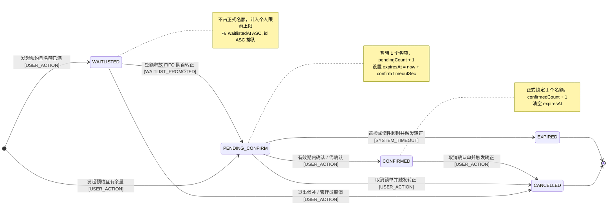

# System Architecture & API Contract (`docs/architecture.md`)

本文档定义「高并发活动预约与排队候补系统（Queue & Reservation Service）」的仓库边界、技术栈选型、Clean Architecture 分层约束、并发防超卖机制、状态机、后台巡检 Worker、RBAC 边界以及完整的前后端 REST/Zod 契约。

> **关联真相源（Truth Anchors）**
> - 视觉与交互基准：[demo/](file:///home/shenyun/dev/queue-reservation/demo)（由静态原型提供页面跳转与交互契约）
> - 架构决策记录：[docs/decisions.md](file:///home/shenyun/dev/queue-reservation/docs/decisions.md)（所有技术权衡、利弊分析与面试表达）
> - 数据模型与 Seed 契约：[docs/database.md](file:///home/shenyun/dev/queue-reservation/docs/database.md)（ER 模型、约束/索引、Prisma 7 规范与 Seed 契约）
> - 实施计划与门禁：`docs/plan.md`（数据模型定稿后落盘）

---

## 1. 技术栈与运行时约定

| 层级 | 选型 | 版本/关键说明 |
| :--- | :--- | :--- |
| **包管理与单仓** | `pnpm workspace` | 统一管理 `packages/shared`、`backend`、`frontend` |
| **运行时** | Node.js | **`v26.13.1`**（开发与容器基线统一使用 Node 26） |
| **共享契约层** | TypeScript + Zod | `packages/shared` 存放所有状态枚举、错误码、请求/响应 Zod Schema 与推导类型 |
| **后端框架** | Hono (`@hono/node-server`) + Zod | 轻量、原生 TypeScript、路由/校验与业务逻辑严格解耦 |
| **ORM 与数据库** | **Prisma 7+** (`@prisma/adapter-pg` + `pg`) + PostgreSQL 17 | Prisma 7 采用 `prisma.config.ts` 与 Driver Adapter；运行时 100% ORM Only，物理 `CHECK` 约束落盘于 Prisma Migration DDL |
| **后端测试** | Vitest | 单元测试 + 真实 PostgreSQL 集成测试（并发 20 抢 5、取消转正、超时释放、幂等重放） |
| **前端框架** | React + TypeScript + Vite + Tailwind CSS + shadcn/ui | 严格复用 `src/components/ui/` 原语，对齐 `demo/` 页面结构 |
| **前端数据层** | TanStack Query (React Query) | 3 秒短轮询自动同步看板 + 写操作后即时 `invalidateQueries`（SSE 推送列为未来演进项） |
| **容器编排** | Docker Compose (`compose.yaml`) | 一键拉起 `postgres`、`backend`（自动 migrate + seed）、`frontend` |

---

## 2. Monorepo 目录边界

```text
queue-reservation/
├── package.json                     # 根脚本（dev / build / typecheck / test / db:*）
├── pnpm-workspace.yaml              # workspaces: ['packages/*', 'backend', 'frontend']
├── compose.yaml                     # postgres(17-alpine) + backend + frontend 一键启动
├── demo/                            # 静态 HTML 视觉与交互原型（最高 UI 基准）
├── docs/
│   ├── architecture.md              # 本文件：架构、并发模型与 REST 契约
│   ├── decisions.md                 # 独立 ADR 决策记录（含权衡与面试讲法）
│   ├── database.md                  # ER 模型、表结构、约束/索引、Seed 契约
│   └── plan.md                      # Phase 拆解、Worktree 任务与验收标准
├── packages/
│   └── shared/
│       └── src/
│           ├── enums.ts             # Role, ReservationStatus, AuditTrigger, AvailabilityStatus
│           ├── errors.ts            # ErrorCode 常量与错误响应 Schema
│           ├── envelope.ts          # 统一响应信封 { data, meta? } / { error }
│           ├── schemas/             # user / event / reservation / audit / admin / stress Zod Schemas
│           └── index.ts             # 统一导出
├── backend/
│   ├── prisma/
│   │   ├── schema.prisma            # 数据模型定义（Prisma 7）
│   │   ├── migrations/              # Prisma 迁移文件（含 Event CHECK 约束 DDL）
│   │   └── seed.ts                  # 可幂等重跑的初始化 Seed 脚本
│   ├── prisma.config.ts             # Prisma 7 数据源与迁移配置
│   ├── src/
│   │   ├── app.ts                   # Hono 实例组装、全局中间件与错误映射
│   │   ├── server.ts                # HTTP 启动入口 + 定时 Worker 挂载 + 优雅停机
│   │   ├── routes/                  # Handler 层：Header/Body Zod 校验、调 Service、包装信封
│   │   ├── services/                # Usecase 层：状态机、防超卖编排、RBAC、候补转正、压测
│   │   ├── repositories/            # Repository 接口定义 + Prisma 实现 + TransactionManager
│   │   ├── worker/                  # 10 秒超时巡检调度器（与 HTTP 解耦）
│   │   └── lib/                     # PrismaClient(pg adapter)、AppError、Logger、Env、Clock
│   └── tests/
│       └── integration/             # 真实 DB 并发防超卖与状态流转集成测试
└── frontend/
    └── src/
        ├── components/ui/           # shadcn/ui 领域无关组件
        ├── components/layout/       # Topbar（身份切换、触发巡检、重置演示）、AuditDrawer
        ├── features/                # events / reservations / admin / stress-test 业务域
        └── lib/                     # 统一 apiClient（自动注 X-User-Id、解包 data 信封、统一错误处理）
```

---

## 3. Clean Architecture 分层与事务边界

### 3.1 依赖方向红线
严格遵循单向依赖：
```text
routes (Handlers) ──▶ services (Usecases) ──▶ repositories (Interfaces) ◀── repositories/prisma (Impl) ──▶ PrismaClient
```

- **`routes/`**：仅负责解析 `X-User-Id`、`Idempotency-Key`、路径/查询参数与 JSON Body（用 `packages/shared` 的 Zod Schema 校验），调用对应 Service 方法，将返回值包装为统一信封 `{ data, meta? }` 并映射 HTTP 状态码。**严禁导入 `prisma` 或编写业务判断**。
- **`services/`**：承载全部核心业务规则（限购检查、防超卖编排、状态机校验、惰性超时判定、FIFO 候补转正、RBAC 权限校验、审计日志写入）。**严禁耦合 Hono `Context` / HTTP Request/Response，也不直接导入 `PrismaClient`**。
- **`repositories/`**：定义仓储接口（`UserRepository`、`EventRepository`、`ReservationRepository`、`AuditLogRepository`）及其 Prisma 实现。所有数据访问统一通过 Prisma Client（ORM Only）。

### 3.2 `TransactionManager`（回调式 Unit of Work）
为了在不破坏 Clean Architecture 边界的前提下保证跨表写操作（如：锁活动行 + 创建/更新预约 + 更新活动计数 + 候补转正 + 写审计日志）的原子性，抽象轻量 `TransactionManager` 接口注入 Service：

```ts
export interface Repositories {
  users: UserRepository;
  events: EventRepository;
  reservations: ReservationRepository;
  auditLogs: AuditLogRepository;
}

export interface TransactionManager {
  run<T>(work: (repos: Repositories) => Promise<T>): Promise<T>;
}
```

`PrismaTransactionManager` 在底层调用 `prisma.$transaction((tx) => work(createPrismaRepositories(tx)))`，使 Service 无需感知 Prisma 类型，同时天然支持事务内组合多仓储调用。

---

## 4. 高并发防超卖与强一致架构（方案 D）

面对「多用户同一毫秒抢最后 1 个名额」且必须遵守 **ORM Only（禁止运行时手写裸 SQL）** 的约束，采用 **双防线强一致设计**：

### 4.1 第一防线：事务首行 `Event` 行级排他锁串行化（纯 Prisma ORM）
所有涉及单活动名额变动的写事务（发起预约、确认预约、取消预约、Worker 过期回收、清空活动预约），在 `txManager.run(...)` 内的**第一步**必须执行：
```ts
const lockedEvent = await repos.events.lockForUpdate(eventId);
// Prisma 实现：
// tx.event.update({ where: { id: eventId }, data: { lockVersion: { increment: 1 } } })
```
- **原理**：PostgreSQL 执行 `UPDATE` 会自动获取该 `Event` 行的行级排他锁（`FOR NO KEY UPDATE`）直到事务提交。
- **零重试风暴**：同一活动的 20 个并发请求在数据库行锁处自动有序排队串行通过，不会触发 SSI 序列化冲突或乐观锁 CAS 重试风暴；**不同活动之间锁不同行，完全并行互不阻塞**。
- **快照可见性**：在 PostgreSQL 默认 `ReadCommitted` 隔离级别下，事务 B 等待事务 A 提交并释放行锁后，事务 B 后续所有 `SELECT` / `COUNT` 均获取最新已提交快照，必然看到事务 A 的最新名额占用与候补状态。
- **零死锁保证**：全系统所有写事务强制遵守固定加锁顺序 `Event -> Reservation -> ReservationAuditLog`；Worker 按 `eventId` 升序逐活动独立开事务，杜绝交叉加锁。

### 4.2 第二防线：`Event` 冗余计数字段 + PostgreSQL `CHECK` 物理硬约束
在 `Event` 表维护两个受行锁保护的计数字段：`confirmedCount`、`pendingCount`，并在数据库 Migration DDL 中施加物理 `CHECK` 约束：
```sql
ALTER TABLE "events"
  ADD CONSTRAINT "events_capacity_non_negative_chk"
    CHECK ("capacity" > 0 AND "confirmed_count" >= 0 AND "pending_count" >= 0),
  ADD CONSTRAINT "events_no_oversell_chk"
    CHECK ("confirmed_count" + "pending_count" <= "capacity");
```
- 即使应用层未来出现代码 bug，数据库引擎本身会从物理层拒绝任何导致 `confirmed_count + pending_count > capacity` 的事务提交，实现绝对零超卖。
- 看板查询可直接基于 `Event` 计数字段与候补聚合高效计算 `remainingCapacity = capacity - confirmedCount - pendingCount`。

### 4.3 严格幂等控制（`Idempotency-Key`）
- `POST /api/events/:eventId/reservations` **强制要求**请求头携带 `Idempotency-Key`（缺失或为空返回 `400 VALIDATION_ERROR`）。
- 唯一作用域为 `(eventId, userId, idempotencyKey)`：
  1. 在 `Event` 行锁内先按 `(eventId, userId, idempotencyKey)` 查询是否已有记录；若存在则直接返回原预约单（HTTP `200`，`meta.idempotentReplay = true`），不扣名额、不重复排队、不触发限购报错。
  2. 数据库层建立唯一索引 `@@unique([eventId, userId, idempotencyKey])` 作为最终兜底。

---

## 5. 预约状态机与审计日志规范

### 5.1 状态枚举与合法流转



| `fromStatus` | `toStatus` | 触发源 (`trigger`) | 触发条件 | 计数变化 (`Event`) | 联动副作用 |
| :--- | :--- | :--- | :--- | :--- | :--- |
| `null` | `PENDING_CONFIRM` | `USER_ACTION` | 有剩余名额且未超 `maxPerUser` | `pendingCount + 1` | 设置 `expiresAt = now + confirmTimeoutSec` |
| `null` | `WAITLISTED` | `USER_ACTION` | 名额已满且未超 `maxPerUser` | 不变 | 记录 `waitlistedAt = now`，动态返回 `waitlistRank` |
| `PENDING_CONFIRM` | `CONFIRMED` | `USER_ACTION` | `now <= expiresAt` 且为本人或 Admin | `pendingCount - 1`, `confirmedCount + 1` | 清空 `expiresAt`，记录 `confirmedAt = now` |
| `PENDING_CONFIRM` | `EXPIRED` | `SYSTEM_TIMEOUT` | Worker 巡检或确认时惰性检测发现 `now > expiresAt` | `pendingCount - 1` | 清空 `expiresAt`，记录 `expiredAt = now`，**同事务触发 FIFO 队首转正** |
| `PENDING_CONFIRM` | `CANCELLED` | `USER_ACTION` | 本人主动取消或 Admin 强制取消（未过期） | `pendingCount - 1` | 清空 `expiresAt`，记录 `cancelledAt = now`，**同事务触发 FIFO 队首转正** |
| `CONFIRMED` | `CANCELLED` | `USER_ACTION` | 本人主动取消或 Admin 强制取消 | `confirmedCount - 1` | 记录 `cancelledAt = now`，**同事务触发 FIFO 队首转正** |
| `WAITLISTED` | `CANCELLED` | `USER_ACTION` | 本人退出候补或 Admin 强制取消 | 不变 | 记录 `cancelledAt = now`（后续候补顺位自动前移） |
| `WAITLISTED` | `PENDING_CONFIRM` | `WAITLIST_PROMOTED` | 释放出空闲名额且存在候补队列 | `pendingCount + 1` | 选 `(waitlistedAt ASC, id ASC)` 队首，设置新 `expiresAt = now + confirmTimeoutSec` |

> **关键边界说明**：
> - **惰性超时校验**：当用户/Admin 点击确认或取消一条 `PENDING_CONFIRM` 订单时，若此时已 `now > expiresAt`（但 10 秒 Worker 尚未扫描到），服务端在当前 `Event` 行锁事务内**立即将其置为 `EXPIRED`、写入 `SYSTEM_TIMEOUT` 审计日志并触发 FIFO 候补转正**，随后向调用方返回 `409 RESERVATION_EXPIRED`。这保证「已过期绝不允许被确认成功」。
> - **限购口径**：`maxPerUser` 统计用户在当前活动下处于 `CONFIRMED`、`PENDING_CONFIRM`、`WAITLISTED` 三种活跃状态的预约总数；变为 `CANCELLED` 或 `EXPIRED` 后额度自动释放。
> - **单次预约数量**：每次请求固定占 1 个名额（若 `maxPerUser > 1`，允许同一用户发起多次预约，生成多条独立预约单，各自独立流转与取消）。
> - **候补顺位**：不静态存储，查询时按 `(waitlistedAt ASC, id ASC)` 实时计算排在当前记录之前的 `WAITLISTED` 数量 `+ 1`。

### 5.2 审计日志（`ReservationAuditLog`）
每一次状态创建或变更都在同一事务内写入一条不可变日志：
- `reservationId`、`eventId`
- `fromStatus`（首次创建为 `null`）
- `toStatus`
- `trigger`：`USER_ACTION` | `SYSTEM_TIMEOUT` | `WAITLIST_PROMOTED`
- `actorId`：操作用户 ID（系统超时/自动转正时为 `null`；管理员代确认/强制取消时记录管理员 `userId`）
- `note`：人类可读的状态变更说明（如「管理员代确认预约」「未在规定时间内确认，系统已自动释放名额」「有空余名额释放，候补自动转正」）
- `createdAt`

---

## 6. 后台 10 秒超时巡检 Worker 设计（方案 A）

- **部署形态**：内嵌在 `backend` 进程中，模块位于 `backend/src/worker/expiration-worker.ts`，与 HTTP 路由解耦（未来可零改动抽成独立 Worker 容器）。
- **调度机制**：
  - 每 **10 秒** 触发一次 `ReservationService.expireOverdueReservations()`。
  - 内置 `isRunning` 防重入锁，避免慢查询导致重叠执行。
  - 维护内存状态 `lastWorkerRunAt`（并在接口 `meta.lastWorkerRunAt` 返回给运营看板展示）。
  - 进程收到 `SIGINT` / `SIGTERM` 时停止定时器并等待当前轮次完成后优雅退出。
  - 通过环境变量 `ENABLE_EXPIRATION_WORKER` 控制自动开启（开发/容器环境默认 `true`，Vitest 集成测试默认 `false`，测试中直接调用 Service 或手动触发接口验证）。
- **事务粒度**：
  1. 先无锁轻量查询存在 `status = 'PENDING_CONFIRM' AND expiresAt <= now` 的去重 `eventId` 列表（按 `eventId ASC` 排序）。
  2. 针对每个 `eventId` 单独开启一个 `txManager.run(...)` 事务：先锁 `Event` 行 → 二次查询已过期的 `PENDING_CONFIRM` 记录 → 逐条置为 `EXPIRED`（`pendingCount - 1` + 写 `SYSTEM_TIMEOUT` 日志）→ 每释放 1 个名额即尝试转正 1 个 FIFO 队首候补（`pendingCount + 1` + 写 `WAITLIST_PROMOTED` 日志）。
  3. 即使未来多实例部署，因与用户写请求共享同一 `Event` 行锁，绝无重复过期或重复转正问题。

---

## 7. RBAC 权限与关键业务边界（对齐 `demo/`）

本项目通过请求头 `X-User-Id` 识别当前模拟账号（无真实 JWT），但**所有权限隔离与字段裁剪必须在后端强校验**，绝不依赖前端隐藏 DOM：

1. **角色分离**：
   - `USER`（C 端普通用户，Seed 预置 5 人：`Alice`、`Bob`、`Charlie`、`Diana`、`Evan`）：
     - 仅可浏览活动公开信息与可用状态（`AVAILABLE` / `WAITLIST_ONLY`），**后端裁剪掉 `capacity`、`confirmedCount`、`pendingCount`、`waitlistedCount`、`remainingCapacity`、`confirmTimeoutSec` 等敏感运营数据**。
     - 仅可发起预约、查看/确认/取消**本人**的预约、查看**本人**的审计日志。
   - `ADMIN`（运营管理员，Seed 预置 1 人：`Admin`）：
     - 可查看全量活动实时看板 KPI、全量预约名册与候补队列、全局统计与 `lastWorkerRunAt`。
     - 可创建活动、对任意用户的预约执行**代确认 / 强制取消**、查看任意预约的审计日志、手动触发超时巡检、重置演示数据、执行 P1 并发压测与清空活动预约。
     - **禁止作为 C 端自己下单**：调用 `POST /api/events/:eventId/reservations` 时，后端校验 `user.role === 'USER'`，管理员调用直接返回 `403 FORBIDDEN`。
2. **`maxPerUser > 1` 的前端交互边界**：
   - 前端正式版在活动详情页不能仅读取第 1 条活跃预约；应展示该用户在本活动下的**全部活跃预约列表**，只要 `myActiveReservations.length < event.maxPerUser`，仍显示「继续预约」按钮并允许针对每条活跃预约单独确认/取消/查看进度。
3. **压测虚拟用户隔离（`User.isSimulated`）**：
   - `User` 表增加 `isSimulated: boolean`（默认 `false`）。
   - P1 并发压测自动创建/复用的虚拟压测用户（如 `sim-{batch}-{i}`）标记为 `isSimulated = true`，以满足 PostgreSQL 外键约束。
   - `GET /api/users` 默认仅返回 `isSimulated = false` 的 6 个常规模拟账号，不污染顶部账号切换器。

---

## 8. 统一 REST API 契约

### 8.1 统一响应信封与错误规范

- **成功响应（HTTP `200` / `201`）**：
  ```json
  {
    "data": { "...": "..." },
    "meta": {
      "requestId": "req-uuid",
      "serverTime": "2026-11-21T13:00:00.000Z"
    }
  }
  ```
  > 注：`meta` 可按接口携带扩展字段，例如 `idempotentReplay: boolean`、`lastWorkerRunAt: string | null`、`total: number`。

- **错误响应（HTTP `4xx` / `5xx`）**：
  ```json
  {
    "error": {
      "code": "RESERVATION_EXPIRED",
      "message": "该预约已超过确认时限，名额已自动释放",
      "details": {}
    }
  }
  ```

- **统一请求头**：
  - `X-User-Id`: 当前操作用户 ID（除 `GET /api/health`、`GET /api/users` 外均建议携带；写接口与鉴权接口必填，缺失返回 `401 UNAUTHORIZED`，不存在返回 `401 USER_NOT_FOUND`）。
  - `Idempotency-Key`: `POST /api/events/:eventId/reservations` **必填**，缺失或空串返回 `400 VALIDATION_ERROR`。

- **稳定错误码清单**：
  | ErrorCode | HTTP Status | 语义 |
  | :--- | :--- | :--- |
  | `VALIDATION_ERROR` | `400` | 请求参数、Body 或必填 Header（含 `Idempotency-Key`）校验失败 |
  | `UNAUTHORIZED` | `401` | 缺失 `X-User-Id` |
  | `USER_NOT_FOUND` | `401` | `X-User-Id` 对应用户不存在 |
  | `FORBIDDEN` | `403` | 越权访问（如普通用户调 Admin 接口、访问他人预约/审计日志、Admin 尝试下单） |
  | `EVENT_NOT_FOUND` | `404` | 活动不存在 |
  | `RESERVATION_NOT_FOUND` | `404` | 预约单不存在 |
  | `EVENT_ENDED` | `409` | 活动已结束，停止接受预约 |
  | `MAX_PER_USER_EXCEEDED` | `409` | 用户在该活动的活跃预约数已达 `maxPerUser` 上限 |
  | `RESERVATION_EXPIRED` | `409` | 确认时发现锁单已超时（同时已在服务端完成过期与候补转正） |
  | `INVALID_STATE_TRANSITION` | `409` | 当前预约状态不允许执行该操作（如已取消/已确认单再次确认） |
  | `INTERNAL_ERROR` | `500` | 未知服务端异常（不透出数据库或堆栈细节） |

### 8.2 接口总览（P0 与 P1）

#### P0 核心闭环接口

| 方法与路径 | 权限 | 说明 | 请求要点 | 响应 `data` / `meta` 要点 |
| :--- | :--- | :--- | :--- | :--- |
| `GET /api/health` | 公开 | 健康检查 | - | `data: { status: 'ok', db: 'up', workerEnabled: boolean, lastWorkerRunAt }` |
| `GET /api/users` | 公开 | 获取顶部模拟切换账号列表 | `?includeSimulated=false` | `data: UserDto[]`（默认仅返回 5 个普通用户 + 1 个 Admin） |
| `GET /api/events` | `USER \| ADMIN` | 活动列表（按角色裁剪字段） | Header: `X-User-Id` | `USER`: 活动基本信息 + `availabilityStatus` + `myActiveReservations[]`；<br>`ADMIN`: 活动全部规则 + `stats { capacity, confirmedCount, pendingCount, waitlistedCount, occupiedCount, remainingCapacity, oversold }`；<br>`meta: { total, lastWorkerRunAt }` |
| `POST /api/events` | `ADMIN` | 创建新活动 | Header: `X-User-Id`<br>Body: `{ name, description?, startTime, endTime, capacity, maxPerUser, confirmTimeoutSec }` | `201`, `data: AdminEventDto` |
| `GET /api/events/:eventId` | `USER \| ADMIN` | 活动详情 | Header: `X-User-Id`<br>Query(Admin): `?tab=OCCUPIED\|WAITLISTED\|ENDED\|ALL` | `USER`: `{ event: PublicEventDto, myActiveReservations, myHistory }`；<br>`ADMIN`: `{ event: AdminEventDto, reservations: ReservationWithUserDto[] }` |
| `POST /api/events/:eventId/reservations` | `USER`（禁 `ADMIN`） | **发起预约（核心防超卖 + 严格幂等）** | Header: `X-User-Id`, `Idempotency-Key` | `201`（幂等重放为 `200`）<br>`data: ReservationDetailDto`（含 `status`, `expiresAt`, `waitlistRank`）<br>`meta: { idempotentReplay: boolean }` |
| `GET /api/reservations/me` | `USER` | 查询「我的预约」列表 | Header: `X-User-Id`<br>Query: `?status=ALL\|PENDING_CONFIRM\|CONFIRMED\|WAITLISTED\|ENDED` | `data: ReservationWithEventDto[]`（含实时 `waitlistRank` 与活动摘要） |
| `POST /api/reservations/:id/confirm` | 本人 或 `ADMIN` | 确认预约（支持 Admin 代确认 + 惰性超时） | Header: `X-User-Id` | `200`, `data: ReservationDetailDto`；若超时返回 `409 RESERVATION_EXPIRED` |
| `POST /api/reservations/:id/cancel` | 本人 或 `ADMIN` | 取消预约（并同事务触发 FIFO 队首转正） | Header: `X-User-Id` | `200`, `data: { reservation: ReservationDetailDto, promotedReservation: ReservationDetailDto \| null }` |
| `GET /api/reservations/:id/audit-logs` | 本人 或 `ADMIN` | 单笔预约完整状态变更时间线（详情抽屉） | Header: `X-User-Id` | `200`, `data: { reservation: ReservationSummaryDto, logs: AuditLogDto[] }` |
| `POST /api/admin/worker/expire` | `ADMIN` | 手动立即触发一次超时巡检 | Header: `X-User-Id` | `200`, `data: { expiredCount, promotedCount, lastWorkerRunAt }` |
| `POST /api/admin/reset-seed` | `ADMIN`（非生产） | 重置演示数据库回初始 Seed 状态 | Header: `X-User-Id` | `200`, `data: { reset: true, eventsCount, usersCount }` |

#### P1 并发压测加分接口

| 方法与路径 | 权限 | 说明 | 请求要点 | 响应 `data` 要点 |
| :--- | :--- | :--- | :--- | :--- |
| `DELETE /api/events/:eventId/reservations` | `ADMIN` | 清空指定活动预约与审计日志并重置计数（便于从 0 压测） | Header: `X-User-Id` | `200`, `data: { deletedReservationsCount }` |
| `POST /api/events/:eventId/simulate-burst` | `ADMIN` | **服务端同毫秒并发压测**（自动准备 N 个 `isSimulated=true` 用户并以 `Promise.all` 并发调用真实预约 Service） | Header: `X-User-Id`<br>Body: `{ concurrency: 20 }`（范围 1~50） | `200`, `data: { eventStatsAfter, summary: { totalRequests, pendingCount, waitlistedCount, failedCount, durationMs, oversold }, results: [{ index, userId, userName, idempotencyKey, ok, reservation?, waitlistRank?, error?, latencyMs }] }` |

---

## 9. 前端数据同步与工程规范

- **统一 `apiClient`**：
  - 自动从当前模拟用户上下文注入 `X-User-Id`。
  - 发起预约时自动生成 UUID 作为 `Idempotency-Key`（按钮禁用防双击，网络异常重试时复用同一 key）。
  - 统一解包 `{ data, meta }`，并将 `{ error }` 映射为标准化的 `ApiError` 供 Toast 与错误边界展示。
- **实时同步策略（方案 A）**：
  - 活动看板、活动详情、我的预约列表通过 TanStack Query 设置 `refetchInterval: 3000`（3 秒短轮询），保证后台 10 秒 Worker 自动释放/转正后最多 3 秒内前端自动刷新。
  - 任何写操作（预约、确认、取消、创建活动、手动巡检、压测、重置）成功后立即 `invalidateQueries` 实现即时反馈。
  - 待确认倒计时基于服务端返回的 `expiresAt` 与 `meta.serverTime` 偏移量本地每秒递减渲染。
- **四态完整**：所有页面严格处理 `loading`（骨架/加载态）、`empty`、`error`（含重试按钮）、`success`。

---

## 10. 运行、日志与容器编排

- **日志落盘**：
  - 后端与前端开发启动脚本统一将 `stdout`/`stderr` 重定向写入 `.logs/backend.log` 与 `.logs/frontend.log`。
  - 后端使用结构化 JSON 日志（记录 `requestId`、`method`、`path`、`status`、`durationMs`、`userId`、Worker 巡检摘要及异常堆栈，严禁打印敏感凭证）。
- **一键容器编排（`compose.yaml`）**：
  - `postgres`：`postgres:17-alpine`，带 `pg_isready` 健康检查与持久化卷。
  - `backend`：Node `26.13.1` 镜像，依赖 `postgres` healthy，启动命令自动执行 `prisma migrate deploy && prisma db seed` 后拉起 Hono 服务（暴露 `3000`）。
  - `frontend`：Vite 静态构建由 Nginx 托管并反向代理 `/api/*` 至 `backend:3000`（暴露 `5173` 或 `8080`）。

---

## 11. 未来演进路线（Future Roadmap）

以下能力超出 3 小时 MVP 范围，但在当前架构中已预留清晰演进路径：

1. **实时推送升级（SSE — Server-Sent Events）**：
   - 将当前 3 秒短轮询升级为 `GET /api/events/:eventId/stream` SSE 推送通道；在 `ReservationService` 事务提交后发布领域事件（`reservation.changed` / `event.stats.updated`），实现看板与候补顺位的毫秒级无感刷新。
2. **独立 Worker 进程与分布式调度**：
   - 将 `backend/src/worker/` 拆出为独立容器入口；多实例部署时可增加 PostgreSQL Advisory Lock 或任务队列（如 BullMQ / Redis）减少无效扫描，当前基于 `Event` 行锁的幂等设计可直接平滑过渡。
3. **高并发写吞吐进一步扩展**：
   - 若单活动峰值从百级提升至万级 QPS，可在前置网关增加 Redis Lua 预扣令牌 + 异步削峰写库，PostgreSQL 行锁与 `CHECK` 约束作为最终落库强一致防线。
4. **真实认证鉴权与多票种支持**：
   - 将 `X-User-Id` 替换为标准 JWT / OAuth2 中间件（仅改动 `routes/` 鉴权中间件，Service 层无感）；扩展单次预约数量 `quantity` 与阶梯票档。
