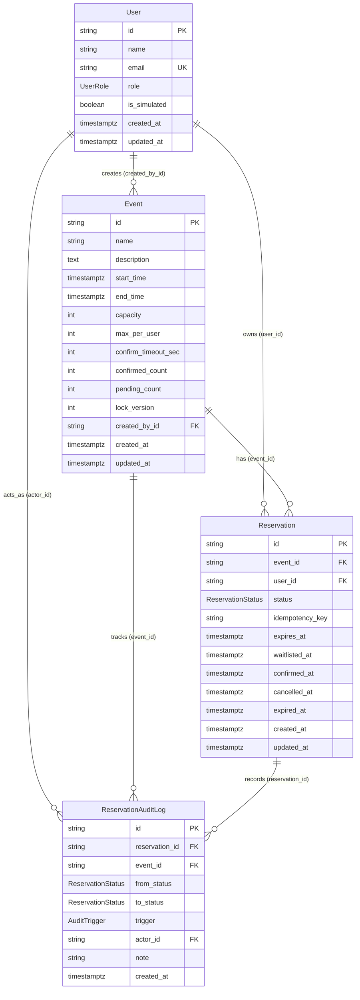

# Database Design (`docs/database.md`)

本文档基于 [demo/](file:///home/shenyun/dev/queue-reservation/demo) 与 [docs/architecture.md](file:///home/shenyun/dev/queue-reservation/docs/architecture.md) 产出，定义系统的数据模型、ER 关系、约束与索引、Prisma 7 映射规范及 Seed 初始化契约。

---

## 1. 存储选型与降级策略

- **主数据库**：PostgreSQL `17-alpine`（统一使用 `TIMESTAMPTZ(3)` 存储 UTC 时间戳，前端按本地时区展示）。
- **ORM 与驱动**：Prisma `7+`（采用 `backend/prisma.config.ts` 配置数据源，运行时通过 `@prisma/adapter-pg` + `pg` 连接池访问）。
- **ORM Only 原则**：运行时所有 CRUD 与事务行锁（`tx.event.update`）100% 通过 Prisma Client 完成，**禁止运行时手写裸 SQL**；数据库物理 `CHECK` 约束统一落盘在 Prisma 迁移文件 `prisma/migrations/*/migration.sql`（DDL 层）。
- **对象存储与非持久化状态说明**：
  - 本项目不涉及文件/图片上传，暂不建 `Storage` 资产表（保留规范扩展能力）。
  - 后台巡检最近执行时间 `lastWorkerRunAt` 为单实例运行态遥测指标，保存在后端 Worker 内存中并通过接口 `meta.lastWorkerRunAt` 返回，不额外建配置表避免过度设计。

---

## 2. ER 关系图（Mermaid）



---

## 3. 核心表结构与约束

### 3.1 枚举定义（PostgreSQL Native Enum）

| 枚举名 | 可选值 | 说明 |
| :--- | :--- | :--- |
| `UserRole` | `USER`, `ADMIN` | C 端普通用户 / 运营管理员 |
| `ReservationStatus` | `PENDING_CONFIRM`, `CONFIRMED`, `WAITLISTED`, `CANCELLED`, `EXPIRED` | 预约单生命周期 5 状态 |
| `AuditTrigger` | `USER_ACTION`, `SYSTEM_TIMEOUT`, `WAITLIST_PROMOTED` | 审计日志触发源 |

### 3.2 `users`（模拟用户表）

承载常规演示账号（5 User + 1 Admin）及 P1 并发压测动态生成的虚拟用户。

| 字段（Prisma / DB 列） | 类型 | 可空 | 约束 / 默认值 | 业务说明 |
| :--- | :--- | :---: | :--- | :--- |
| `id` / `id` | `VARCHAR(64)` | 否 | `PK`, `@default(cuid())` | 支持 Seed 固定语义 ID（`u1..u5`, `admin`）及动态 ID |
| `name` / `name` | `VARCHAR(100)` | 否 | - | 展示名称（如 `Alice`、`并发用户 #01`） |
| `email` / `email` | `VARCHAR(255)` | 否 | `UNIQUE` | 唯一邮箱标识 |
| `role` / `role` | `UserRole` | 否 | `DEFAULT 'USER'` | 角色权限标识 |
| `isSimulated` / `is_simulated` | `BOOLEAN` | 否 | `DEFAULT false`, `INDEX(is_simulated, role)` | `true` 表示压测虚拟用户，`GET /api/users` 默认过滤 |
| `createdAt` / `created_at` | `TIMESTAMPTZ(3)` | 否 | `DEFAULT now()` | 创建时间（UTC） |
| `updatedAt` / `updated_at` | `TIMESTAMPTZ(3)` | 否 | `@updatedAt` | 更新时间（UTC） |

### 3.3 `events`（活动与名额配额表）

承载活动基本信息、限购/超时规则、受行锁保护的占座计数与物理防超卖约束。

| 字段（Prisma / DB 列） | 类型 | 可空 | 约束 / 默认值 | 业务说明 |
| :--- | :--- | :---: | :--- | :--- |
| `id` / `id` | `VARCHAR(64)` | 否 | `PK`, `@default(cuid())` | 活动唯一 ID（Seed 为 `evt-1`, `evt-2`） |
| `name` / `name` | `VARCHAR(200)` | 否 | - | 活动名称 |
| `description` / `description` | `TEXT` | 否 | `DEFAULT ''` | 活动简介 |
| `startTime` / `start_time` | `TIMESTAMPTZ(3)` | 否 | `INDEX` | 活动开始时间（UTC） |
| `endTime` / `end_time` | `TIMESTAMPTZ(3)` | 否 | - | 活动结束时间（UTC，须 `> start_time`） |
| `capacity` / `capacity` | `INTEGER` | 否 | `CHECK (> 0)` | 总名额上限 |
| `maxPerUser` / `max_per_user` | `INTEGER` | 否 | `DEFAULT 1`, `CHECK (> 0)` | 单人活跃预约上限 |
| `confirmTimeoutSec` / `confirm_timeout_sec` | `INTEGER` | 否 | `DEFAULT 600`, `CHECK (>= 10)` | 锁单确认超时秒数（默认 10 分钟，最小 10 秒） |
| `confirmedCount` / `confirmed_count` | `INTEGER` | 否 | `DEFAULT 0`, `CHECK (>= 0)` | 当前 `CONFIRMED` 数量（事务内原子维护） |
| `pendingCount` / `pending_count` | `INTEGER` | 否 | `DEFAULT 0`, `CHECK (>= 0)` | 当前 `PENDING_CONFIRM` 数量（事务内原子维护） |
| `lockVersion` / `lock_version` | `INTEGER` | 否 | `DEFAULT 0` | 写事务首行自增以触发 PostgreSQL 行级排他锁串行化 |
| `createdById` / `created_by_id` | `VARCHAR(64)` | 是 | `FK -> users(id)` (`ON DELETE SET NULL`), `INDEX` | 创建该活动的运营管理员 ID（所有权与追踪） |
| `createdAt` / `created_at` | `TIMESTAMPTZ(3)` | 否 | `DEFAULT now()`, `INDEX(DESC)` | 创建时间（列表默认按创建时间倒序） |
| `updatedAt` / `updated_at` | `TIMESTAMPTZ(3)` | 否 | `@updatedAt` | 更新时间 |

**表级物理 `CHECK` 约束（落盘于 Migration SQL）**：
```sql
ALTER TABLE "events"
  ADD CONSTRAINT "events_capacity_positive_chk" CHECK ("capacity" > 0),
  ADD CONSTRAINT "events_max_per_user_positive_chk" CHECK ("max_per_user" > 0),
  ADD CONSTRAINT "events_timeout_min_chk" CHECK ("confirm_timeout_sec" >= 10),
  ADD CONSTRAINT "events_time_window_chk" CHECK ("end_time" > "start_time"),
  ADD CONSTRAINT "events_counts_non_negative_chk" CHECK ("confirmed_count" >= 0 AND "pending_count" >= 0),
  ADD CONSTRAINT "events_no_oversell_chk" CHECK ("confirmed_count" + "pending_count" <= "capacity");
```

### 3.4 `reservations`（预约单与候补队列主表）

每条记录代表 1 个名额的预约或候补申请（`maxPerUser > 1` 时同一用户可拥有多条独立预约单）。

| 字段（Prisma / DB 列） | 类型 | 可空 | 约束 / 默认值 | 业务说明 |
| :--- | :--- | :---: | :--- | :--- |
| `id` / `id` | `VARCHAR(64)` | 否 | `PK`, `@default(cuid())` | 预约单号（Seed 为 `res-101..res-107`） |
| `eventId` / `event_id` | `VARCHAR(64)` | 否 | `FK -> events(id)` (`ON DELETE RESTRICT`) | 所属活动 |
| `userId` / `user_id` | `VARCHAR(64)` | 否 | `FK -> users(id)` (`ON DELETE RESTRICT`) | 预约归属用户（数据所有权） |
| `status` / `status` | `ReservationStatus` | 否 | - | 当前状态 |
| `idempotencyKey` / `idempotency_key` | `VARCHAR(128)` | 否 | `UNIQUE(event_id, user_id, idempotency_key)` | 幂等键（防重复提交） |
| `expiresAt` / `expires_at` | `TIMESTAMPTZ(3)` | 是 | `INDEX(status, expires_at)` | 锁单截止时间；仅 `PENDING_CONFIRM` 时非空 |
| `waitlistedAt` / `waitlisted_at` | `TIMESTAMPTZ(3)` | 是 | `INDEX(event_id, status, waitlisted_at, id)` | 进入候补队列的时间（决定 FIFO 顺位） |
| `confirmedAt` / `confirmed_at` | `TIMESTAMPTZ(3)` | 是 | - | 确认成功时间 |
| `cancelledAt` / `cancelled_at` | `TIMESTAMPTZ(3)` | 是 | - | 取消时间 |
| `expiredAt` / `expired_at` | `TIMESTAMPTZ(3)` | 是 | - | 超时回收时间 |
| `createdAt` / `created_at` | `TIMESTAMPTZ(3)` | 否 | `DEFAULT now()` | 创建时间 |
| `updatedAt` / `updated_at` | `TIMESTAMPTZ(3)` | 否 | `@updatedAt` | 最近状态变更时间 |

**表级物理 `CHECK` 约束（落盘于 Migration SQL）**：
```sql
ALTER TABLE "reservations"
  ADD CONSTRAINT "reservations_pending_expiry_invariant_chk"
    CHECK (
      ("status" = 'PENDING_CONFIRM' AND "expires_at" IS NOT NULL)
      OR ("status" <> 'PENDING_CONFIRM' AND "expires_at" IS NULL)
    ),
  ADD CONSTRAINT "reservations_waitlisted_requires_ts_chk"
    CHECK ("status" <> 'WAITLISTED' OR "waitlisted_at" IS NOT NULL);
```
> 注：双向约束保证 `expires_at` 仅在 `PENDING_CONFIRM` 状态非空；一旦流转为 `CONFIRMED` / `CANCELLED` / `EXPIRED`，必须同步清空 `expires_at`，避免 UI 残留倒计时或扫描歧义。

### 3.5 `reservation_audit_logs`（状态变更审计日志表）

不可变追加表（Append-Only），记录每一次预约创建与状态流转的完整时间线。

| 字段（Prisma / DB 列） | 类型 | 可空 | 约束 / 默认值 | 业务说明 |
| :--- | :--- | :---: | :--- | :--- |
| `id` / `id` | `VARCHAR(64)` | 否 | `PK`, `@default(cuid())` | 日志 ID |
| `reservationId` / `reservation_id` | `VARCHAR(64)` | 否 | `FK -> reservations(id)` (`ON DELETE RESTRICT`) | 关联预约单 |
| `eventId` / `event_id` | `VARCHAR(64)` | 否 | `FK -> events(id)` (`ON DELETE RESTRICT`) | 冗余活动外键，支持按活动直接查询审计流 |
| `fromStatus` / `from_status` | `ReservationStatus` | 是 | - | 变更前状态（首次创建为 `NULL`） |
| `toStatus` / `to_status` | `ReservationStatus` | 否 | - | 变更后状态 |
| `trigger` / `trigger` | `AuditTrigger` | 否 | - | 触发原因：`USER_ACTION` / `SYSTEM_TIMEOUT` / `WAITLIST_PROMOTED` |
| `actorId` / `actor_id` | `VARCHAR(64)` | 是 | `FK -> users(id)` (`ON DELETE SET NULL`), `INDEX` | 操作人 ID（本人或代操作的 Admin；系统触发时为 `NULL`） |
| `note` / `note` | `VARCHAR(500)` | 否 | - | 人类可读的变更说明（直接展示在详情抽屉时间线） |
| `createdAt` / `created_at` | `TIMESTAMPTZ(3)` | 否 | `DEFAULT now()` | 发生时间（UTC） |

### 3.6 外键删除策略汇总

| 外键关系 | 删除策略 | 理由 |
| :--- | :--- | :--- |
| `Event.createdById -> User.id` | `SetNull` | 保留活动历史，不因删除测试管理员而连带删除活动 |
| `Reservation.eventId -> Event.id` | `Restrict` | 防止误删活动导致预约与审计记录静默丢失 |
| `Reservation.userId -> User.id` | `Restrict` | 防止误删用户破坏已占座/候补账目一致性 |
| `ReservationAuditLog.reservationId -> Reservation.id` | `Restrict` | 审计日志为合规/排障事实，禁止级联误删 |
| `ReservationAuditLog.eventId -> Event.id` | `Restrict` | 同上 |
| `ReservationAuditLog.actorId -> User.id` | `SetNull` | 操作人注销时仍保留审计记录 |

> **显式清理与防死锁约定**：
> - `DELETE /api/events/:eventId/reservations`（P1）：事务内**先执行 `lockForUpdate(eventId)` 锁定 `Event` 行**，再按 `reservation_audit_logs -> reservations` 顺序删除并将 `confirmedCount = 0, pendingCount = 0`。
> - `POST /api/admin/reset-seed`：事务内**先按 `id ASC` 顺序锁定全部现有 `Event` 行**（维持与正常预约/Worker 一致的 `events -> reservations -> reservation_audit_logs` 全局加锁顺序，杜绝并发死锁），再显式清空 `reservation_audit_logs -> reservations -> events -> users(isSimulated = true)` 并重建初始 Seed。

---

## 4. 状态机、防超卖并发控制与核心查询索引

### 4.1 状态流转与计数守恒不变量

- 活跃占座状态：`CONFIRMED`、`PENDING_CONFIRM`
- 活跃排队状态：`WAITLISTED`（计入个人 `maxPerUser` 限购，不计入 `capacity`）
- 终态：`CANCELLED`、`EXPIRED`（不可再发生任何状态跃迁）
- **核心数据库不变量（任意已提交事务后恒成立）**：
  1. `Event.confirmedCount === COUNT(Reservation WHERE eventId AND status = 'CONFIRMED')`
  2. `Event.pendingCount === COUNT(Reservation WHERE eventId AND status = 'PENDING_CONFIRM')`
  3. `Event.confirmedCount + Event.pendingCount <= Event.capacity`（由数据库 `CHECK` 物理兜底）
- **写事务加锁协议**：
  1. 任何状态写事务首步执行 `tx.event.update({ where: { id: eventId }, data: { lockVersion: { increment: 1 } } })`，获取该活动行级排他锁；
  2. 固定加锁顺序 `events -> reservations -> reservation_audit_logs`，杜绝死锁；
  3. Worker 扫描到多活动过期单时，按 `eventId ASC` 逐活动独立开启事务处理。

### 4.2 高频查询与索引覆盖（全部纯 Prisma 查询，零 N+1）

| 对应 `demo/` 场景 / API | Prisma 查询模式 | 对应索引 |
| :--- | :--- | :--- |
| 顶部账号切换 `GET /api/users` | `user.findMany({ where: { isSimulated: false }, orderBy: [{ role: 'asc' }, { id: 'asc' }] })` | `users(is_simulated, role)` |
| 活动大厅实时看板 `GET /api/events` | 1) `event.findMany({ orderBy: { createdAt: 'desc' } })`<br>2) `reservation.groupBy({ by: ['eventId'], where: { status: 'WAITLISTED' }, _count: { _all: true } })`（单次聚合计算所有活动候补人数，零 N+1）<br>3) C 端用户额外单次查 `reservation.findMany({ where: { userId, status: { in: ACTIVE } } })` | `events(created_at DESC)`<br>`reservations(event_id, status, waitlisted_at, id)`<br>`reservations(user_id, updated_at DESC)` |
| 幂等重放检测 `POST .../reservations` | `reservation.findUnique({ where: { eventId_userId_idempotencyKey: ... } })` | `UNIQUE(event_id, user_id, idempotency_key)` |
| 单人限购检查 `maxPerUser` | `reservation.count({ where: { eventId, userId, status: { in: ['CONFIRMED','PENDING_CONFIRM','WAITLISTED'] } } })` | `reservations(event_id, user_id, status)` |
| FIFO 候补队首转正 | `reservation.findFirst({ where: { eventId, status: 'WAITLISTED' }, orderBy: [{ waitlistedAt: 'asc' }, { id: 'asc' }] })` | `reservations(event_id, status, waitlisted_at, id)` |
| 动态计算候补顺位 `waitlistRank` | 单条：`reservation.count({ where: { eventId, status: 'WAITLISTED', OR: [{ waitlistedAt: { lt } }, { waitlistedAt: eq, id: { lte } }] } })`<br>列表批量：单次拉取目标活动 `WAITLISTED` ID 有序列表在内存中构造 `Map<reservationId, rank>`，彻底消除 N+1 | `reservations(event_id, status, waitlisted_at, id)` |
| 10 秒超时巡检扫描 | `reservation.findMany({ where: { status: 'PENDING_CONFIRM', expiresAt: { lte: now } }, select: { eventId: true }, distinct: ['eventId'], orderBy: { eventId: 'asc' } })` | `reservations(status, expires_at)` |
| 「我的预约」列表 `GET /api/reservations/me` | `reservation.findMany({ where: { userId, ...statusFilter }, include: { event: true }, orderBy: { updatedAt: 'desc' } })` | `reservations(user_id, updated_at DESC)` |
| 活动详情名册 Tab `GET /api/events/:id` | `reservation.findMany({ where: { eventId, ...tabFilter }, include: { user: true }, orderBy: tab === 'WAITLISTED' ? [{ waitlistedAt: 'asc' }, { id: 'asc' }] : [{ updatedAt: 'desc' }] })` | `reservations(event_id, status, waitlisted_at, id)`<br>`reservations(event_id, updated_at DESC)` |
| 审计抽屉时间线 `GET /api/reservations/:id/audit-logs` | `reservationAuditLog.findMany({ where: { reservationId }, include: { actor: true }, orderBy: [{ createdAt: 'asc' }, { id: 'asc' }] })` | `reservation_audit_logs(reservation_id, created_at ASC, id ASC)` |

> **排序注意事项**：由于每次预约写事务都会自增 `events.lock_version`（从而联动 `@updatedAt`），活动列表统一按 `events.created_at DESC` 排序，**禁止按 `events.updated_at` 排序**以免列表顺序随抢单跳动。

### 4.3 目标 Prisma 7 Schema 与配置落地规范

> **Prisma 7 关键变更约束**：
> 1. `schema.prisma` 的 `datasource db` 中**禁止写 `url = env(...)`**（否则触发 `P1012` 错误），数据源 URL 统一配置在 `backend/prisma.config.ts`。
> 2. `generator client` 使用 Prisma 7 默认的 Rust-free ESM 客户端 `provider = "prisma-client"` 并显式声明 `output`。
> 3. 自定义 `CHECK` 约束统一通过 `prisma migrate dev --create-only` 写入受版本控制的 `migration.sql` 文件，严禁使用 `prisma db push` 导致迁移漂移。

**`backend/prisma.config.ts` 参考**：
```ts
import 'dotenv/config';
import { defineConfig, env } from 'prisma/config';

export default defineConfig({
  schema: 'prisma/schema.prisma',
  migrations: {
    path: 'prisma/migrations',
    seed: 'tsx prisma/seed.ts',
  },
  datasource: {
    url: env('DATABASE_URL'),
  },
});
```

**`backend/prisma/schema.prisma` 完整映射**：
```prisma
generator client {
  provider = "prisma-client"
  output   = "../src/generated/prisma"
}

datasource db {
  provider = "postgresql"
}

enum UserRole {
  USER
  ADMIN
}

enum ReservationStatus {
  PENDING_CONFIRM
  CONFIRMED
  WAITLISTED
  CANCELLED
  EXPIRED
}

enum AuditTrigger {
  USER_ACTION
  SYSTEM_TIMEOUT
  WAITLIST_PROMOTED
}

model User {
  id            String                @id @default(cuid()) @db.VarChar(64)
  name          String                @db.VarChar(100)
  email         String                @unique @db.VarChar(255)
  role          UserRole              @default(USER)
  isSimulated   Boolean               @default(false) @map("is_simulated")
  createdAt     DateTime              @default(now()) @map("created_at") @db.Timestamptz(3)
  updatedAt     DateTime              @updatedAt @map("updated_at") @db.Timestamptz(3)

  createdEvents Event[]               @relation("EventCreator")
  reservations  Reservation[]
  auditActions  ReservationAuditLog[] @relation("AuditActor")

  @@index([isSimulated, role])
  @@map("users")
}

model Event {
  id                String                @id @default(cuid()) @db.VarChar(64)
  name              String                @db.VarChar(200)
  description       String                @default("") @db.Text
  startTime         DateTime              @map("start_time") @db.Timestamptz(3)
  endTime           DateTime              @map("end_time") @db.Timestamptz(3)
  capacity          Int
  maxPerUser        Int                   @default(1) @map("max_per_user")
  confirmTimeoutSec Int                   @default(600) @map("confirm_timeout_sec")
  confirmedCount    Int                   @default(0) @map("confirmed_count")
  pendingCount      Int                   @default(0) @map("pending_count")
  lockVersion       Int                   @default(0) @map("lock_version")
  createdById       String?               @map("created_by_id") @db.VarChar(64)
  createdAt         DateTime              @default(now()) @map("created_at") @db.Timestamptz(3)
  updatedAt         DateTime              @updatedAt @map("updated_at") @db.Timestamptz(3)

  createdBy         User?                 @relation("EventCreator", fields: [createdById], references: [id], onDelete: SetNull)
  reservations      Reservation[]
  auditLogs         ReservationAuditLog[]

  @@index([startTime])
  @@index([createdAt(sort: Desc)])
  @@index([createdById])
  @@map("events")
}

model Reservation {
  id             String                @id @default(cuid()) @db.VarChar(64)
  eventId        String                @map("event_id") @db.VarChar(64)
  userId         String                @map("user_id") @db.VarChar(64)
  status         ReservationStatus
  idempotencyKey String                @map("idempotency_key") @db.VarChar(128)
  expiresAt      DateTime?             @map("expires_at") @db.Timestamptz(3)
  waitlistedAt   DateTime?             @map("waitlisted_at") @db.Timestamptz(3)
  confirmedAt    DateTime?             @map("confirmed_at") @db.Timestamptz(3)
  cancelledAt    DateTime?             @map("cancelled_at") @db.Timestamptz(3)
  expiredAt      DateTime?             @map("expired_at") @db.Timestamptz(3)
  createdAt      DateTime              @default(now()) @map("created_at") @db.Timestamptz(3)
  updatedAt      DateTime              @updatedAt @map("updated_at") @db.Timestamptz(3)

  event          Event                 @relation(fields: [eventId], references: [id], onDelete: Restrict)
  user           User                  @relation(fields: [userId], references: [id], onDelete: Restrict)
  auditLogs      ReservationAuditLog[]

  @@unique([eventId, userId, idempotencyKey])
  @@index([eventId, status, waitlistedAt, id])
  @@index([status, expiresAt])
  @@index([eventId, userId, status])
  @@index([userId, updatedAt(sort: Desc)])
  @@index([eventId, updatedAt(sort: Desc)])
  @@map("reservations")
}

model ReservationAuditLog {
  id            String             @id @default(cuid()) @db.VarChar(64)
  reservationId String             @map("reservation_id") @db.VarChar(64)
  eventId       String             @map("event_id") @db.VarChar(64)
  fromStatus    ReservationStatus? @map("from_status")
  toStatus      ReservationStatus  @map("to_status")
  trigger       AuditTrigger
  actorId       String?            @map("actor_id") @db.VarChar(64)
  note          String             @db.VarChar(500)
  createdAt     DateTime           @default(now()) @map("created_at") @db.Timestamptz(3)

  reservation   Reservation        @relation(fields: [reservationId], references: [id], onDelete: Restrict)
  event         Event              @relation(fields: [eventId], references: [id], onDelete: Restrict)
  actor         User?              @relation("AuditActor", fields: [actorId], references: [id], onDelete: SetNull)

  @@index([reservationId, createdAt(sort: Asc), id(sort: Asc)])
  @@index([eventId, createdAt(sort: Desc)])
  @@index([actorId])
  @@map("reservation_audit_logs")
}
```

---

## 5. Seed 初始化契约（`backend/prisma/seed.ts`）

严格对齐 [demo/app.js](file:///home/shenyun/dev/queue-reservation/demo/app.js) 首屏演示场景，确保 `compose up` 启动后立即完整可演示。

### 5.1 预置用户（5 普通用户 + 1 管理员，`isSimulated = false`）

| `id` | `name` | `email` | `role` |
| :--- | :--- | :--- | :--- |
| `u1` | `Alice` | `alice@example.com` | `USER` |
| `u2` | `Bob` | `bob@example.com` | `USER` |
| `u3` | `Charlie` | `charlie@example.com` | `USER` |
| `u4` | `Diana` | `diana@example.com` | `USER` |
| `u5` | `Evan` | `evan@example.com` | `USER` |
| `admin` | `Admin（运营管理员）` | `admin@example.com` | `ADMIN` |

> **P1 压测虚拟用户命名规范**：`POST /api/events/:eventId/simulate-burst` 动态创建的虚拟用户统一采用 `id = sim-${batchId}-${i}`、`name = 并发用户 #${pad(i)}`、`email = sim-${batchId}-${i}@sim.local`、`role = USER`、`isSimulated = true`，避免 `email` 唯一键冲突且不污染顶部切换器。

### 5.2 预置活动（2 个活动，时间相对当前 `now` 动态计算为未来日期，避免过期）

| `id` | `name` | `description` | 活动时间窗 | `capacity` | `maxPerUser` | `confirmTimeoutSec` | 初始计数 | `createdById` |
| :--- | :--- | :--- | :--- | :---: | :---: | :---: | :--- | :--- |
| `evt-1` | `LINE FRIENDS 限量快闪店入场券` | `热门限量线下主题快闪体验，凭确认后的预约凭证扫码入场。` | `now + 4天 10:00 ~ 18:00` | `5` | `1` | `600` (10分钟) | `confirmed=2, pending=1` (剩 2 席) | `admin` |
| `evt-2` | `2026 高并发架构线下沙龙` | `一线架构师面对面交流，席位有限，满额后可登记候补。` | `now + 7天 14:00 ~ 17:00` | `3` | `1` | `45` (短超时) | `confirmed=2, pending=1` (满额 + 1 候补) | `admin` |

### 5.3 预置预约单（7 笔）与审计日志（11 条）

> 时间线严格按因果时序自洽，且全部满足 `events_no_oversell_chk` 与 `reservations_pending_expiry_invariant_chk` 物理约束。

| `id` | `eventId` | `userId` | `status` | 关键时间字段（均以 `now` 为基准） | 初始审计日志 |
| :--- | :--- | :--- | :--- | :--- | :--- |
| `res-101` | `evt-1` | `u2` (Bob) | `CONFIRMED` | `createdAt = now - 10m`, `confirmedAt = now - 5m`, `expiresAt = null` | `null -> PENDING_CONFIRM` (`-10m`)、`PENDING_CONFIRM -> CONFIRMED` (`-5m`) |
| `res-102` | `evt-1` | `u3` (Charlie) | `CONFIRMED` | `createdAt = now - 10m`, `confirmedAt = now - 5m`, `expiresAt = null` | `null -> PENDING_CONFIRM` (`-10m`)、`PENDING_CONFIRM -> CONFIRMED` (`-5m`) |
| `res-103` | `evt-1` | `u4` (Diana) | `PENDING_CONFIRM` | `createdAt = now - 120s`, `expiresAt = now + 480s` (`createdAt + 600s`) | `null -> PENDING_CONFIRM` (`-120s`) |
| `res-104` | `evt-2` | `u1` (Alice) | `CONFIRMED` | `createdAt = now - 10m`, `confirmedAt = now - 5m`, `expiresAt = null` | `null -> PENDING_CONFIRM` (`-10m`)、`PENDING_CONFIRM -> CONFIRMED` (`-5m`) |
| `res-105` | `evt-2` | `u2` (Bob) | `CONFIRMED` | `createdAt = now - 10m`, `confirmedAt = now - 5m`, `expiresAt = null` | `null -> PENDING_CONFIRM` (`-10m`)、`PENDING_CONFIRM -> CONFIRMED` (`-5m`) |
| `res-106` | `evt-2` | `u3` (Charlie) | `PENDING_CONFIRM` | `createdAt = now - 10s`, `expiresAt = now + 35s` (`createdAt + 45s`) | `null -> PENDING_CONFIRM` (`-10s`) |
| `res-107` | `evt-2` | `u4` (Diana) | `WAITLISTED` | `createdAt = now - 5s`, `waitlistedAt = now - 5s`, `expiresAt = null` | `null -> WAITLISTED` (`-5s`) |

> 每条预置预约单的 `idempotencyKey` 使用固定语义值 `seed-${id}`（如 `seed-res-101`）；每条审计日志的 `actorId` 对应预约归属 `userId`，`trigger` 为 `USER_ACTION`。

### 5.4 幂等启动 vs 强制重置行为

- **容器启动自动 Seed（`prisma db seed`）**：检查 `users` 与 `events` 是否已存在数据；若库为空则写入上述完整初始数据集，若已有数据则仅 `upsert` 6 个常规用户后直接跳过，**确保重启容器不覆盖运行中产生的演示数据**。
- **管理台「重置演示数据」（`POST /api/admin/reset-seed`）**：在单一事务内**先按 `id ASC` 顺序锁定全部现有 `Event` 行**（防止与后台 Worker 或在途请求死锁），再按顺序显式清空 `reservation_audit_logs -> reservations -> events -> users(isSimulated = true)`，最后完整重建上述 6 用户、2 活动、7 预约单（重新计算相对 `now` 的 `expiresAt` 与未来活动时间窗）及 11 条审计日志。
